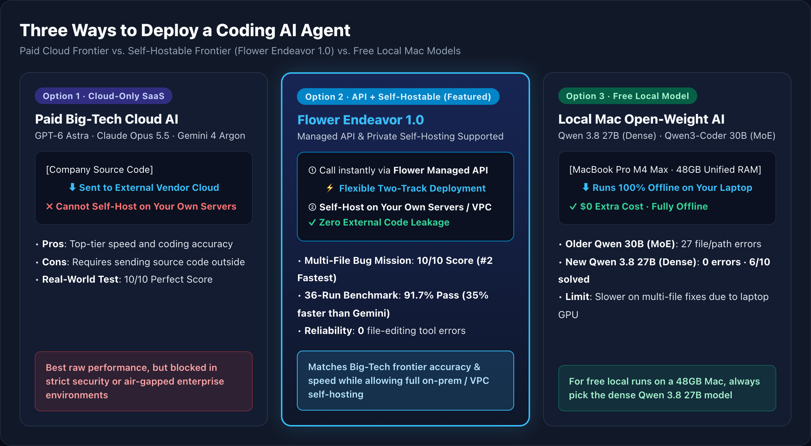
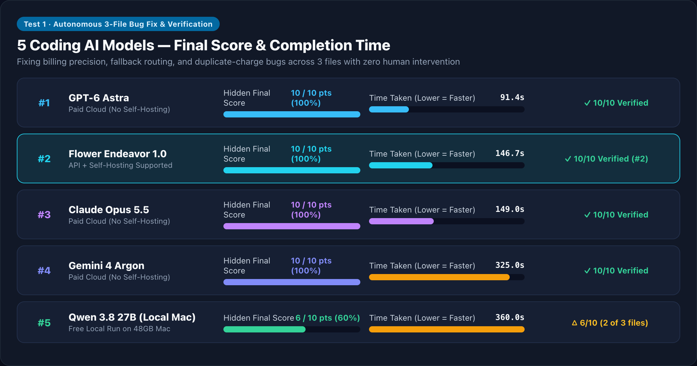
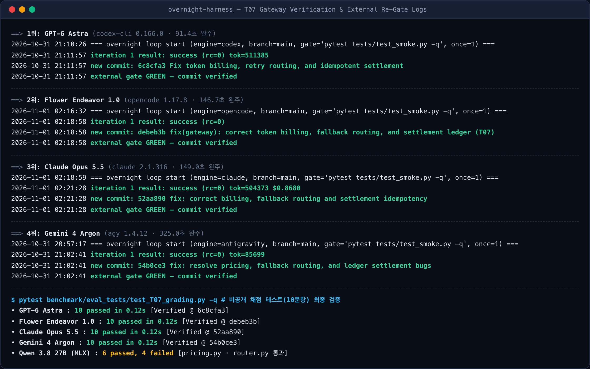
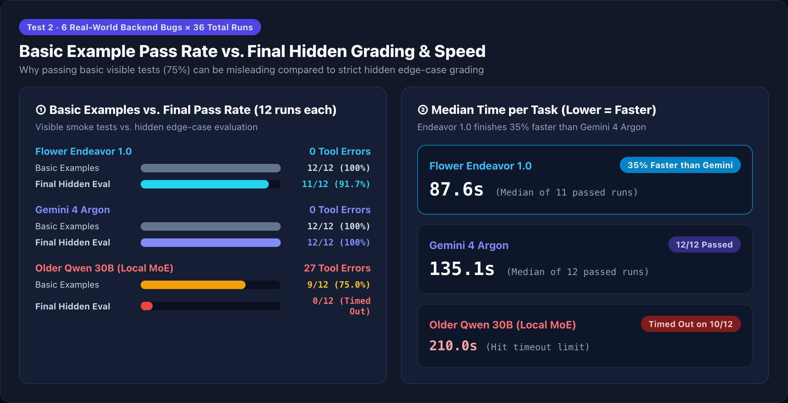
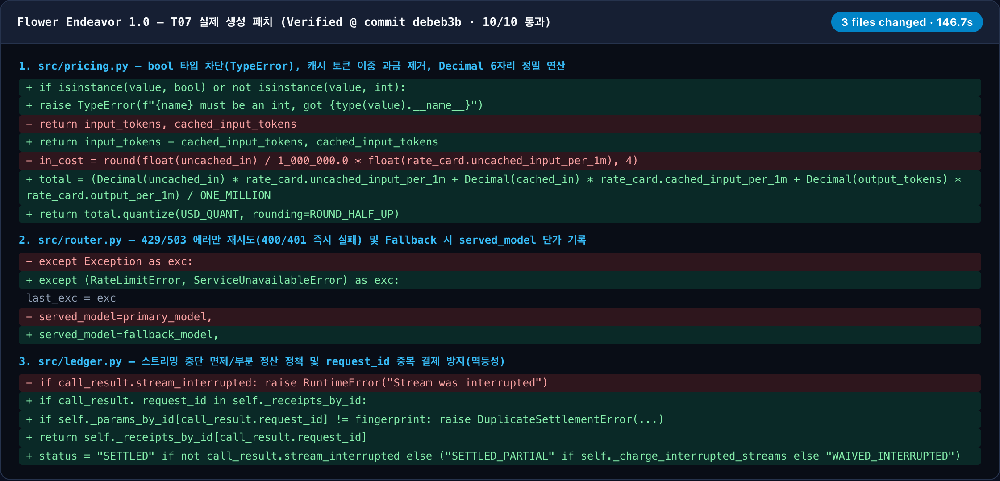
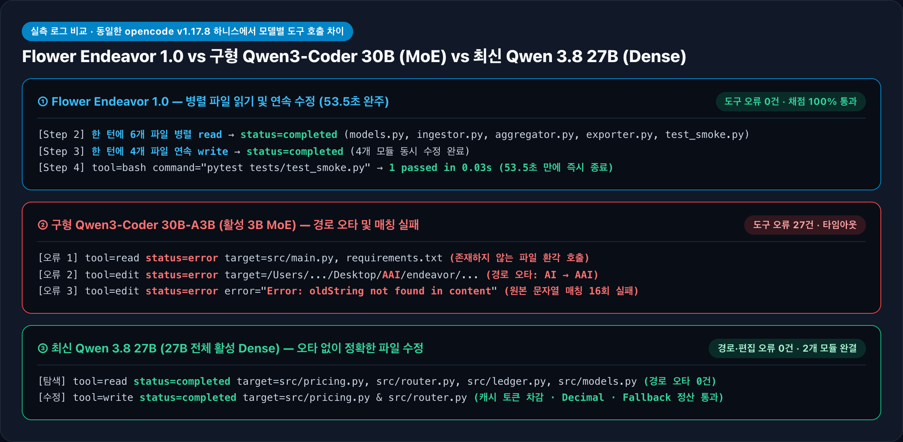

# Flower Endeavor 1.0 Early Access Review: Benchmarking 5 Coding AI Agents

_Testing Paid Big-Tech Cloud Models, Self-Hostable Flower Endeavor 1.0, and Free Local Mac Models Across 41 Real-World Software Engineering Runs_



> **3-Bullet Summary**
>
> - **What we tested**: We benchmarked paid Big-Tech cloud models (**GPT-6 Astra · Claude Opus 5.5 · Gemini 4 Argon**), the **self-hostable frontier model [Flower Endeavor 1.0](https://flower.ai/docs/model/endeavor.html)**, and free local Mac models (**Qwen**) on real multi-file backend bug fixes.
> - **What we found**: **Flower Endeavor 1.0** achieved a **10/10 perfect score** on our autonomous 3-file production bug-fix mission—tying the paid cloud giants while finishing **#2 overall in speed (146.7s)**. Across 36 repeated backend runs, it finished **35% faster than Gemini 4 Argon**.
> - **Why it matters**: For engineering teams that cannot send proprietary source code to external vendor clouds, **Flower Endeavor 1.0 is the most practical way to get Big-Tech frontier coding performance on your own servers (Self-Hosting)**.

---

## 1. Plain-English Overview: What Is ‘Flower Endeavor 1.0’?

Modern engineering teams are moving beyond chat-only AI to **Coding Agents**—AI tools that directly open files on your computer, edit code across multiple modules, and run tests on their own.

However, adopting a coding agent at work usually forces a tough trade-off:

1. **Paid Big-Tech Cloud AI (`GPT-6 Astra`, `Claude Opus 5.5`, `Gemini 4 Argon`)**
   - Best-in-class coding skill, but **you cannot install them on your own company servers.** Every file the agent reads is sent to an external cloud provider, which is a dealbreaker for finance, defense, semiconductor, and regulated enterprise teams.
2. **Free Local AI on Your Laptop (`Qwen` open-weight models)**
   - Runs 100% offline on a MacBook for **$0 extra cost**, keeping code completely private. However, when a task requires coordinated edits across multiple files, smaller local models often get stuck or time out.

**[Flower Endeavor 1.0](https://flower.ai/docs/model/endeavor.html)**—which we tested via early access—bridges this exact gap:

- **Who built it?**: Created by **Flower Labs** (the team behind the leading open-source federated learning framework), Endeavor 1.0 is a frontier-class model supporting up to a **1-million-token context window** (hundreds of books of code at once).
- **Key Differentiator (Self-Hosting Support)**:
  - You can call it instantly through the **Flower Managed API**, OR
  - Deploy it **directly inside your company’s own servers or private VPC (Self-Hosting)** so that **zero lines of source code ever leave your network**.

<details>
<summary>🔍 [Empirical Data 1] Flower Endeavor 1.0 Official Specs & Full 6-Configuration Testbed Details</summary>

### Flower Endeavor 1.0 (`flwrlabs/endeavor-1.0`) Fact-Check

- **Model Scope**: Designed not as a narrow autocomplete model, but as a **frontier general-purpose model built for deep reasoning, software engineering, and long-horizon agent workflows** ([Official Documentation](https://flower.ai/docs/model/endeavor.html)).
- **Context Window**: Up to **1,000,000 (1M) tokens**.
- **Published Benchmarks**: `HumanEval` (Coding) **98.2%**, `AIME 2026` (Math) **99.9%**, `IFEval` (Instruction Following) **94.1%**, `GPQA` (Science Reasoning) **92.0%**.
- **Two-Track Deployment**: Supports both instant Managed API access and Private Self-Hosting (On-Premise / Dedicated VPC).

### The 6 Tested Configurations (MacBook Pro · Apple M4 Max · 48GB Unified Memory)

| Category | Model (`Model ID`) | Agent CLI Harness | Execution Environment | Self-Hostable? |
| :--- | :--- | :--- | :--- | :---: |
| **Self-Hostable Frontier** | **Flower Endeavor 1.0** (`flwrlabs/endeavor-1.0`) | `opencode 1.17.8` | Flower Early Access API | **Yes (On-Prem / Private VPC)** |
| **Paid Cloud Frontier** | **GPT-6 Astra** (`gpt-6-astra`) | `codex 0.166.0` | OpenAI Cloud | No |
| **Paid Cloud Frontier** | **Claude Opus 5.5** (`claude-opus-5-5`) | `claude 2.1.316` | Anthropic Cloud | No |
| **Paid Cloud Frontier** | **Gemini 4 Argon** (`gemini-4-argon`) | `agy 1.4.12` | Google Cloud | No |
| **Local Mac (New Dense)** | **Qwen 3.8 27B** (`Qwen3.8-27B-4bit`, 14.98GB) | `opencode` + `mlx-lm 0.31.1` | Local M4 Max 48GB (All 27B active per token) | **100% Local ($0)** |
| **Local Mac (Older MoE)** | **Qwen3-Coder 30B** (`Qwen3-Coder-30B-A3B-4bit`, 16.02GB) | `opencode` + `mlx-lm 0.31.1` | Local M4 Max 48GB (Only 3B active per token) | **100% Local ($0)** |

</details>

---

## 2. How Did We Test Them? (2 Real-World Engineering Trials)

Instead of textbook algorithm puzzles, we tested whether each AI could **autonomously find, fix, and verify real backend bugs from start to finish with zero human help**.

> **💡 How We Graded: ‘Basic Examples’ vs. ‘Hidden Final Grading’**
>
> - **Basic Example Tests (Visible)**: Simple checks the AI is allowed to run while working to see if its code runs.
> - **Hidden Final Grading (Private)**: Strict edge-case tests hidden from the AI. We run these after the AI finishes to verify whether it truly solved every requirement without breaking existing features.

1. **Test 1 (Autonomous 3-File Bug Fix Mission)**:
   - A realistic production incident where the AI must fix **6 intertwined bugs across 3 files** (token billing calculation, fallback server routing, and duplicate charge prevention), pass tests, and commit the fix on its own.
2. **Test 2 (36-Run Repeated Backend Benchmark)**:
   - 6 common backend bug categories run twice per model (**36 total runs**) to measure both **accuracy** and **median completion speed**.

<details>
<summary>🔍 [Empirical Data 2] Why We Chose These 7 Tasks — Detailed Task Design & Edge Cases</summary>

Each task (`T01`–`T07`) models a real production failure mode where naive patches pass basic smoke tests but fail in production:

| Task ID | Task Name (Files Touched) | Real-World Engineering Trap Tested | Visible / Hidden Tests |
| :---: | :--- | :--- | :---: |
| **T01** | Webhook Input Validator (`1 file`) | In Python, `isinstance(True, int)` is `True` (`bool` subclasses `int`). Must reject booleans and normalize emails. | 3 / **8** |
| **T02** | Cursor Paginator (`1 file`) | Deduplicate boundary items across pages, skip empty pages, and detect infinite cursor loops. | 2 / **6** |
| **T03** | Retry Budget Client (`1 file`) | Respect total remaining `timeout_budget` against `Retry-After` headers and return exact `attempt` count on failure. | 2 / **6** |
| **T04** | Layered Config Loader (`2 files`) |Falsy values (`0`, `False`, `""`, `[]`) in higher-priority layers must not be overwritten by default fallbacks. | 2 / **6** |
| **T05** | Invoice Money Migration (`4 files`) | Migrate `float` amounts to integer cents (`Money`) while preserving backward compatibility for `api_version="v1"`. | 2 / **6** |
| **T06** | Windowed Event Aggregator (`4 files`) | Filter late events via watermark bounds and separate timeout errors (`504`) from generic error counts. | 2 / **6** |
| **T07** | **LLM Gateway & Billing Recovery (`3 files`)** | **Fix cached-token double billing + bill the actual fallback model used + enforce idempotent `request_id` settlement.** | 4 / **10** |

</details>

---

## 3. Benchmark Results & 5-Model Ranking

### Result 1: Autonomous 3-File Bug Fix — 5-Model Scoreboard

Here is how the 5 models performed when tasked with fixing the 3-file gateway and billing incident completely on their own:



| Rank | AI Model | Deployment Type | Final Hidden Score | Time Taken | Key Takeaway |
| :---: | :--- | :--- | :---: | :---: | :--- |
| **#1** | **GPT-6 Astra** | Paid Cloud (No Self-Hosting) | **10 / 10 (100%)** | **91.4s** | Fastest overall with a perfect score |
| **#2** | **Flower Endeavor 1.0** | **API + Self-Hosting Supported** | **10 / 10 (100%)** | **146.7s** | **Tied for 1st in score + #2 fastest overall** |
| **#3** | **Claude Opus 5.5** | Paid Cloud (No Self-Hosting) | **10 / 10 (100%)** | **149.0s** | Clean, reliable perfect score |
| **#4** | **Gemini 4 Argon** | Paid Cloud (No Self-Hosting) | **10 / 10 (100%)** | **325.0s** | Thorough verification with a perfect score |
| **#5** | **Qwen 3.8 27B** | Free Local Run on 48GB Mac | **6 / 10 (60%)** | 360.0s | Fixed 2 of 3 files cleanly before timeout |

- **Key Highlight**: **Flower Endeavor 1.0** matched the paid cloud giants with a **perfect 10/10 verified score** and finished **#2 in speed (146.7s)**—ahead of both Claude Opus 5.5 (149.0s) and Gemini 4 Argon (325.0s).

<details>
<summary>🔍 [Empirical Data 3] Verified Terminal Logs & Git Commit Hashes (overnight-harness)</summary>

Below is the actual terminal output from our autonomous verification harness (`overnight-harness`), showing `external gate GREEN — commit verified` and the 10-test hidden `pytest` suite results across all models:



| Model (`CLI Harness`) | Visible Smoke (`4`) | Hidden Grading (`10`) | Elapsed Time | Autonomous Verification Gate & Commit Hash |
| :--- | :---: | :---: | :---: | :--- |
| **GPT-6 Astra** (`codex 0.166.0`) | 4 / 4 | **10 / 10 (100%)** | **91.4s** | `external gate GREEN — commit verified` (`6c8cfa3`) |
| **Flower Endeavor 1.0** (`opencode 1.17.8`) | 4 / 4 | **10 / 10 (100%)** | **146.7s** | `external gate GREEN — commit verified` (`debeb3b`) |
| **Claude Opus 5.5** (`claude 2.1.316`) | 4 / 4 | **10 / 10 (100%)** | **149.0s** | `external gate GREEN — commit verified` (`52aa890`) |
| **Gemini 4 Argon** (`agy 1.4.12`) | 4 / 4 | **10 / 10 (100%)** | **325.0s** | `external gate GREEN — commit verified` (`54b0ce3`) |
| **Qwen 3.8 27B** (`opencode` + MLX) | 2 / 4 | **6 / 10 (60%)** | 360.0s | Completed `pricing.py` & `router.py` (`0` edit tool errors) |

</details>

---

### Result 2: 36-Run Repeated Backend Benchmark — Speed & Accuracy

In our second trial, we ran **Flower Endeavor 1.0**, **Gemini 4 Argon**, and an **older local Mac model (Qwen 30B MoE)** across 6 backend tasks twice each (**36 total runs**).



| AI Model | Basic Examples Passed | Final Hidden Grading Passed | File Edit Mistakes | Median Time per Task |
| :--- | :---: | :---: | :---: | :---: |
| **Flower Endeavor 1.0** | **12 / 12 (100%)** | **11 / 12 (91.7%)** | **0** | **87.6s** *(35% faster than Gemini)* |
| **Gemini 4 Argon** | **12 / 12 (100%)** | **12 / 12 (100%)** | **0** | **135.1s** |
| **Older Qwen 30B (Local Mac)** | 9 / 12 (75.0%) | **0 / 12 (Timed Out)** | **27** | **210.0s** *(Timed out on 10 of 12 runs)* |

- **35% Faster Completion**: Among runs that finished normally and passed hidden grading, **Endeavor 1.0 took a median of 87.6s** compared to **135.1s for Gemini 4 Argon**—cutting wait time by **35.2%**.

<details>
<summary>🔍 [Empirical Data 4] Full 36-Run Task-by-Task Table & Statistical Definitions</summary>

### Statistical Definitions for Time & Success

- **Autonomous Pass (Normal Exit + Hidden Eval Pass)**: The agent exits cleanly (`exit=0`) within the time limit and passes 100% of the hidden evaluation test suite.
- **Median Completion Time Basis**:
  - **Flower Endeavor 1.0**: Median of **87.6s** across the 11 passed runs (`mean 86.2s`, range `53.5–119.5s`). Including the single edge-case miss (`T01` Rep 2, `122.9s`), the all-12-run median is **91.2s** (still **32.5% faster** than Gemini).
  - **Gemini 4 Argon**: Median of **135.1s** across all 12 passed runs (`mean 135.5s`, range `81.8–198.1s`).
  - **Older Qwen3-Coder 30B (Local MoE)**: Timed out on **10 of 12 runs**, yielding an all-12-run median of **210.0s**. Only 2 runs exited normally before timeout (`T03` Rep 1 at `90.5s` and `T05` Rep 1 at `185.3s`, median `137.9s`), and both failed hidden grading. Its single passing patch (`T02` Rep 1 at `210.0s`) was scored from files left on disk when the timeout killed the process.

### Complete 36-Run Breakdown (`T01`–`T06` × 2 Repeats)

| Task | Repeat | Flower Endeavor 1.0 | Gemini 4 Argon | Older Qwen3-Coder 30B (Local) |
| :---: | :---: | :--- | :--- | :--- |
| **T01** | Rep 1 | **PASS** (`78.6s` · 8/8) | **PASS** (`86.5s` · 8/8) | FAIL (`210.0s timeout` · 7/8) |
| **T01** | Rep 2 | FAIL (`122.9s` · 7/8) | **PASS** (`118.2s` · 8/8) | FAIL (`210.0s timeout` · 7/8) |
| **T02** | Rep 1 | **PASS** (`59.1s` · 6/6) | **PASS** (`81.8s` · 6/6) | Patch passed at timeout (`210.0s` · 6/6) |
| **T02** | Rep 2 | **PASS** (`93.1s` · 6/6) | **PASS** (`90.2s` · 6/6) | FAIL (`210.0s timeout` · 5/6) |
| **T03** | Rep 1 | **PASS** (`86.9s` · 6/6) | **PASS** (`136.4s` · 6/6) | FAIL (`90.5s normal exit` · 5/6) |
| **T03** | Rep 2 | **PASS** (`87.6s` · 6/6) | **PASS** (`153.2s` · 6/6) | FAIL (`210.0s timeout` · 5/6) |
| **T04** | Rep 1 | **PASS** (`98.4s` · 6/6) | **PASS** (`146.9s` · 6/6) | FAIL (`210.0s timeout` · 0/6) |
| **T04** | Rep 2 | **PASS** (`89.4s` · 6/6) | **PASS** (`133.7s` · 6/6) | FAIL (`210.0s timeout` · 0/6) |
| **T05** | Rep 1 | **PASS** (`104.0s` · 6/6) | **PASS** (`167.2s` · 6/6) | FAIL (`185.3s normal exit` · 5/6) |
| **T05** | Rep 2 | **PASS** (`119.5s` · 6/6) | **PASS** (`198.1s` · 6/6) | FAIL (`360.1s timeout` · 5/6) |
| **T06** | Rep 1 | **PASS** (`53.5s` · 6/6) | **PASS** (`174.1s` · 6/6) | FAIL (`210.0s timeout` · 5/6) |
| **T06** | Rep 2 | **PASS** (`78.1s` · 6/6) | **PASS** (`139.2s` · 6/6) | FAIL (`210.0s timeout` · 0/6) |

</details>

---

## 4. Three Key Findings from the Execution Logs

### ① Why Is Endeavor 1.0 So Fast? — “Read in Parallel, Edit in One Shot”

On our 4-file event-aggregation task (`T06`), **Endeavor 1.0 finished with a perfect score in just 53.5 seconds**.

- **How Endeavor 1.0 works**: It read all 6 relevant files **in parallel on Turn 1**, wrote clean fixes to all 4 target files **in a single batch on Turn 2**, verified the test suite, and exited immediately with **0 tool errors**.
- **How the older local model struggled**: It guessed non-existent filenames (`main.py`) or mistyped directory paths (`/Desktop/AAI/`), burning 27 failed tool calls until time ran out.

### ② Why Passing ‘Basic Examples (75%)’ Is Not Enough

The older local model (`Qwen 30B`) passed the visible example tests on **9 out of 12 runs (75%)**, yet failed almost every hidden final evaluation.

- **Why**: It wrote patches that satisfied the obvious happy path while dropping subtle requirements like **preserving legacy `v1` API compatibility** or **returning the exact retry count when a timeout budget runs out**.
- **Takeaway**: Never trust an agent just because its basic smoke test turns green—an independent edge-case test gate is essential.

### ③ Choosing a Free Local Model on a 48GB Mac: Why ‘New 27B Dense’ Beats ‘Older 30B MoE’

Testing two free local models on the same 48GB MacBook Pro revealed a dramatic difference:

- **Older Qwen 30B (Sparse MoE — only 3B active per token)**: Although the file says "30B", it only activates **3B parameters per token** to save compute. Under long agent prompts, its attention drifted—producing **27 path and string-matching errors**.
- **New Qwen 3.8 27B (Dense — all 27B active per token)**: Activates **all 27B parameters on every token**. On the exact same MacBook, it made **0 path or editing mistakes** and solved 60% (`6/10`) of the complex 3-file gateway mission.

<details>
<summary>🔍 [Empirical Data 5] Actual Git Diff Patch (Endeavor 1.0) & Raw JSONL Tool-Call Logs</summary>

### 1) Actual Git Diff Generated by Flower Endeavor 1.0 on Test 1 (`10/10 Verified`)

Below is the exact `git diff` produced autonomously by Flower Endeavor 1.0 across `pricing.py`, `router.py`, and `ledger.py`:



### 2) Raw JSONL Tool-Call Log Comparison Across the Three Models

Actual JSONL event traces captured from `opencode` comparing **Flower Endeavor 1.0**, **Older Qwen3-Coder 30B (MoE)**, and **New Qwen 3.8 27B (Dense)**:



### 3) Code-Level Comparison: Why Smoke-Passing Local Patches Failed Hidden Grading

**Case A — `T03` Retry Count Bug (Exited in `90.5s`, passed smoke test, failed hidden grading)**

```python
# [Older Qwen3-Coder 30B Patch]
# Bug: Returns configured max_attempts (4) instead of actual attempts performed (1) when budget is exceeded
if remaining < delay:
    return RetryResult(ok=False, status=response.status, attempts=self.max_attempts, elapsed=elapsed)

# [Flower Endeavor 1.0 Verified Patch]
# Correctly returns the actual `attempt` counter
if attempt >= self.max_attempts or sleep_time > remaining_budget:
    return RetryResult(ok=False, status=resp.status, attempts=attempt, elapsed=self.clock.now() - start_time)
```

**Case B — `T05` Legacy `v1` Compatibility Bug (Exited in `185.3s`, passed smoke test, failed hidden grading)**

```python
# [Older Qwen3-Coder 30B Patch]
# Bug: Drops the `api_version` parameter and always returns v2 format, breaking legacy v1 callers
def create_invoice_response(customer_id: str, raw_items: list[dict], discount_percent: int = 0, tax_rate_bps: int = 0) -> dict:
    ...
    return format_invoice_v2(invoice)

# [Flower Endeavor 1.0 Verified Patch]
# Preserves backward compatibility for `api_version="v1"` while defaulting to `v2`
def create_invoice_response(customer_id: str, raw_items: list[dict], discount_percent: int = 0, tax_rate_bps: int = 0, api_version: str = "v2") -> dict:
    ...
    if api_version == "v1":
        return format_invoice_v1(invoice)
    return format_invoice_v2(invoice)
```

</details>

---

## 5. Conclusion: Which Coding AI Should Your Team Choose?

Here is our practical decision guide based on 41 real-world benchmark runs:

| Your Team's Situation | Recommended Model | Measured Result | Why Choose It |
| :--- | :--- | :--- | :--- |
| **External cloud is allowed & raw speed is #1** | **GPT-6 Astra** | **10/10 Verified** · **91.4s (#1)** | Fastest end-to-end completion when cloud SaaS is permitted |
| **Strict code security + Frontier performance needed (Featured)** | **Flower Endeavor 1.0** | **10/10 Verified** · **146.7s (#2)** / **91.7% Pass (87.6s)** | **Delivers Big-Tech frontier accuracy and speed while supporting full on-prem / private VPC self-hosting** |
| **External cloud is allowed & thorough verification is priority** | **Claude Opus 5.5** / **Gemini 4 Argon** | **10/10 Verified** / **100% Pass (Gemini)** | Ideal when you want exhaustive edge-case checking on cloud APIs |
| **Running 100% free ($0) and offline on a 48GB MacBook** | **New Qwen 3.8 27B (Dense)** | **6/10 Score** · **0 Edit Errors** | Smartest free local model on a 48GB Mac without path or edit errors |

<details>
<summary>🔍 [Empirical Data 6] Benchmark Reproduction Commands</summary>

```bash
# 1. Start local MLX inference server (Apple Silicon 48GB+)
python -m mlx_lm.server --model mlx-community/Qwen3.8-27B-4bit --port 18080

# 2. Run Test 1 (T07 Multi-File Gateway Recovery with overnight-harness verification)
python benchmark/run_t07_overnight.py \
  --models endeavor,gpt_astra,claude_opus,gemini,qwen38 \
  --timeout 360

# 3. Run Test 2 (T01-T06 36-Run Repeated Backend Suite)
python benchmark/runner.py \
  --models endeavor,gemini,qwen_local \
  --tasks T01_webhook_validator,T02_cursor_paginator,T03_retry_budget,T04_config_hierarchy,T05_money_migration,T06_windowed_metrics \
  --repeats 2 \
  --timeout 360
```

</details>
