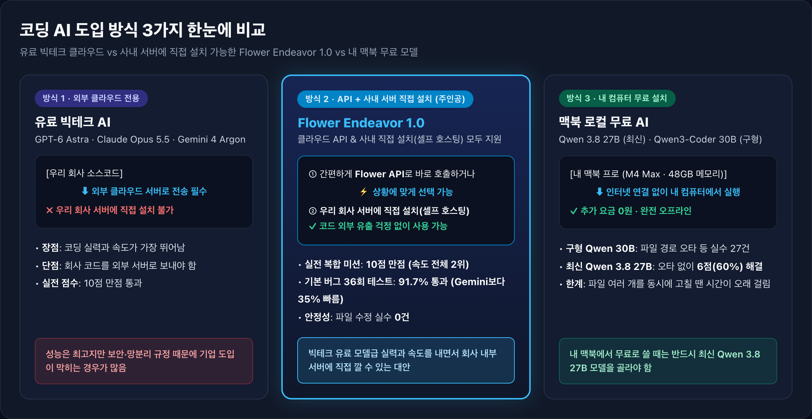
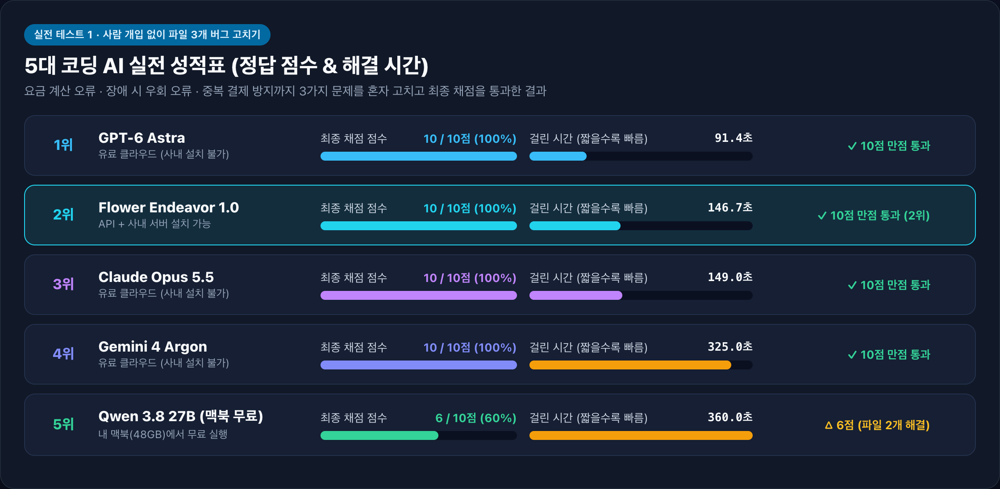
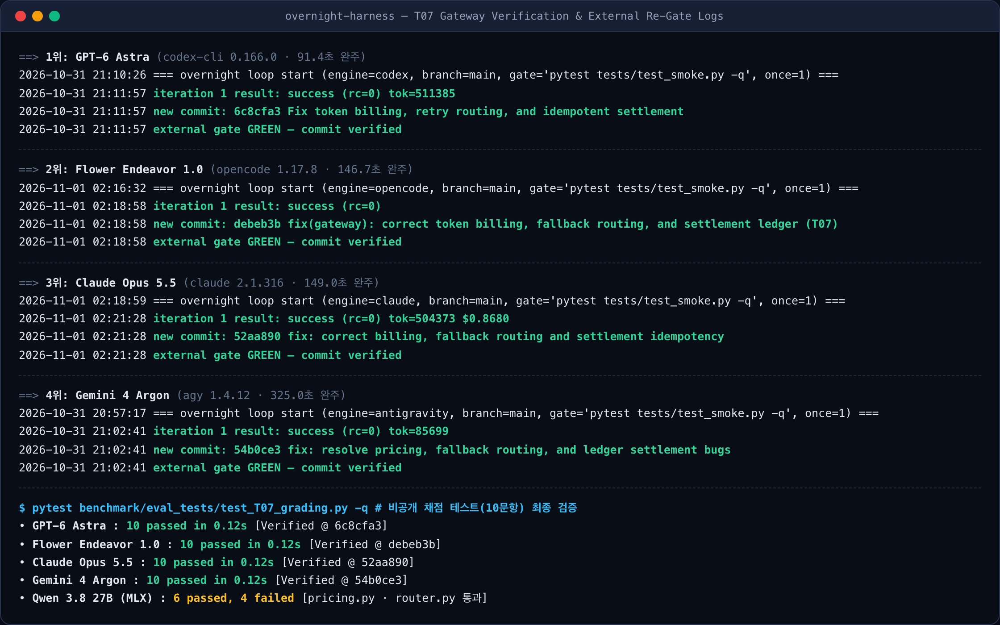
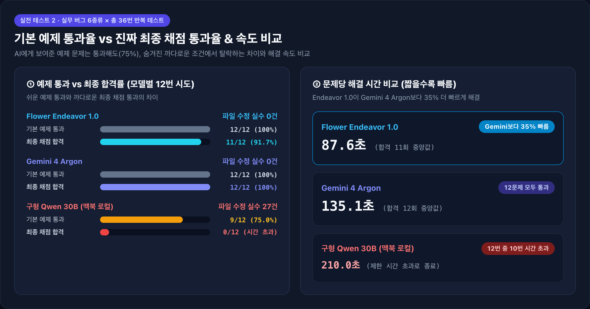
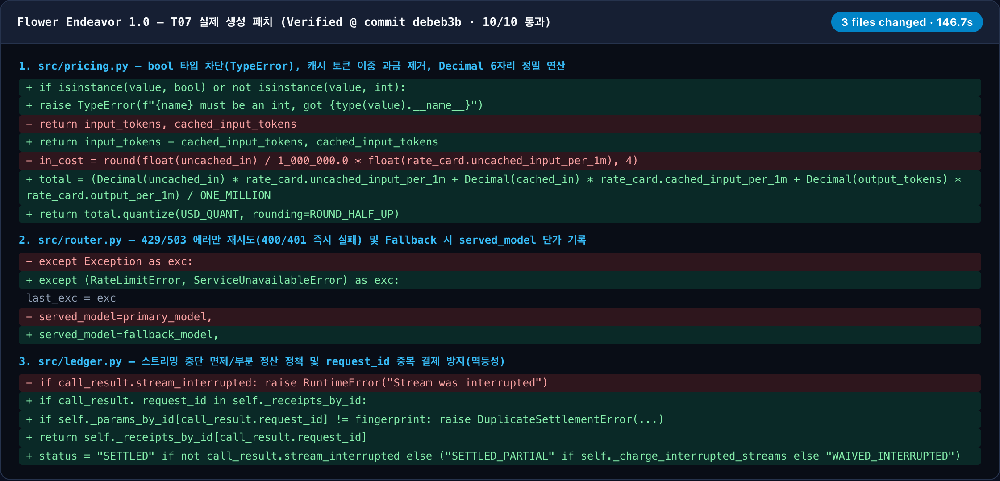
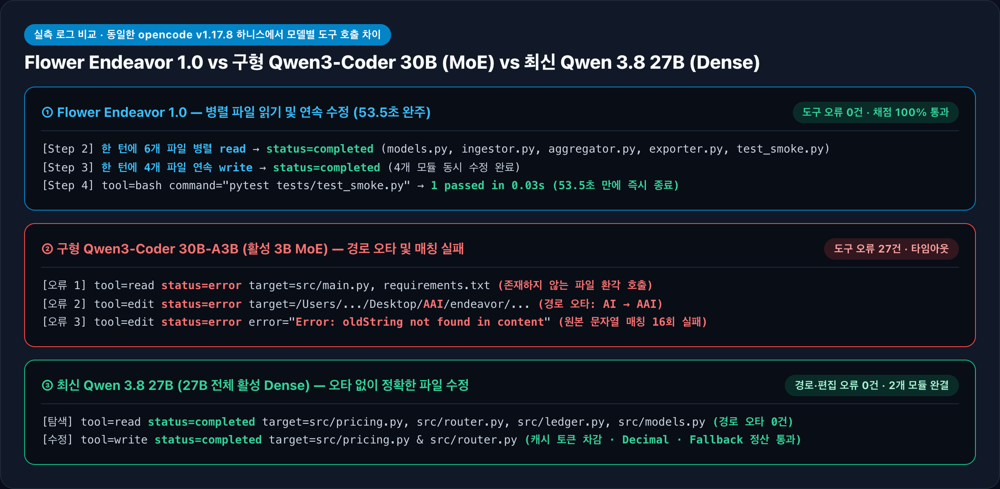

# Flower Endeavor 1.0 얼리 액세스 실사용 후기

_유료 빅테크 클라우드 AI, 사내 서버에 직접 설치(셀프 호스팅) 가능한 Flower Endeavor 1.0, 그리고 내 맥북 무료 로컬 모델을 실제 코딩 업무 41회로 비교 검증한 기록_



> **3줄 핵심 요약**
>
> - **무엇을 비교했나?**: 유료 빅테크 클라우드 AI(**GPT-6 Astra · Claude Opus 5.5 · Gemini 4 Argon**), **우리 회사 서버에 직접 설치(셀프 호스팅)할 수 있는 [Flower Endeavor 1.0](https://flower.ai/docs/model/endeavor.html)**, 그리고 내 맥북(48GB)에 무료로 깔아 쓰는 로컬 AI(**Qwen**)에게 실제 코딩 업무를 시켜봤습니다.
> - **결과는 어땠나?**: **Flower Endeavor 1.0**은 파일 3개가 얽힌 실전 복합 버그 수정에서 빅테크 AI들과 똑같이 **10점 만점**을 받았고, 해결 속도는 **전체 2위(146.7초)**를 기록했습니다. 36번 반복 테스트에서도 **Gemini보다 작업 시간을 35% 단축**했습니다.
> - **왜 중요한가?**: 보안 때문에 회사 소스코드를 외부 클라우드로 보낼 수 없는 기업에서, **빅테크 유료 모델급 코딩 실력을 사내 서버에 직접 구축할 수 있는 가장 현실적인 대안**입니다.

---

## 1. 먼저 알기 쉽게 정리: ‘Flower Endeavor 1.0’이 뭔가요?

요즘 개발팀에서는 채팅창에 질문만 하는 AI를 넘어, **AI가 직접 내 컴퓨터의 코드 파일을 열고, 고치고, 테스트까지 돌려주는 ‘코딩 에이전트’**를 많이 씁니다.

하지만 회사에 도입하려고 하면 늘 **두 가지 고민**에 부딪힙니다.

1. **유료 빅테크 클라우드 AI (`GPT-6 Astra`, `Claude Opus 5.5`, `Gemini 4 Argon`)**
   - 실력은 가장 좋지만 **우리 회사 서버에 직접 설치할 수 없습니다.** 모든 소스코드를 빅테크 기업의 외부 서버로 전송해야 해서 금융·반도체·국방·망분리 기업에서는 쓰기 어렵습니다.
2. **내 컴퓨터에 깔아 쓰는 무료 AI (`Qwen` 계열)**
   - 인터넷 없이 내 맥북에서 무료(`0원`)로 안전하게 돌릴 수 있지만, 파일 여러 개를 동시에 고쳐야 하는 복잡한 실무에서는 자주 막힙니다.

이번에 얼리 액세스(사전 체험)로 써본 **[Flower Endeavor 1.0](https://flower.ai/docs/model/endeavor.html)**은 이 두 가지의 장점만 합친 모델입니다.

- **누가 만들었나?**: 글로벌 분산 AI·연합학습 오픈소스로 유명한 **Flower Labs**가 선보인 첫 프론티어 모델입니다. 한 번에 책 수백 권 분량인 **100만(1M) 토큰**까지 읽을 수 있습니다.
- **가장 큰 특징 (셀프 호스팅 가능)**:
  - 평소에 편하게 쓸 때는 **전용 API**로 바로 연결해서 쓸 수 있고,
  - 보안이 중요한 기업은 **회사 내부 서버나 전용 클라우드(VPC)에 직접 설치(셀프 호스팅)**해서 **코드가 회사 밖으로 한 줄도 나가지 않게** 쓸 수 있습니다.

<details>
<summary>🔍 [실증 데이터 1] Flower Endeavor 1.0 공식 사양 및 6개 비교 환경 상세 스펙 펼쳐보기</summary>

### Flower Endeavor 1.0 (`flwrlabs/endeavor-1.0`) 공식 사양 팩트체크

- **모델 성격**: 단순 코드 자동완성 보조 모델이 아니라, **추론·코딩·장기 에이전트 작업을 위해 설계된 프론티어급 범용 모델**입니다 ([공식 문서](https://flower.ai/docs/model/endeavor.html)).
- **컨텍스트 길이**: 최대 **1,000,000 (1M) 토큰** 지원.
- **공식 벤치마크 성적**: 코딩(`HumanEval`) **98.2%**, 수학 추론(`AIME 2026`) **99.9%**, 지시문 준수(`IFEval`) **94.1%**, 과학 추론(`GPQA`) **92.0%**.
- **배포 방식**: Flower Managed API 및 엔터프라이즈 사내 인프라/VPC 직접 배포(Private Deployment / Self-Hosting) 투트랙 지원.

### 실험에 사용한 6개 실행 구성 (MacBook Pro · Apple M4 Max · 48GB 통합 메모리)

| 구분 | 모델명 (`Model ID`) | 실행 도구 (CLI 하니스) | 실행 및 추론 환경 | 사내 셀프 호스팅 |
| :--- | :--- | :--- | :--- | :---: |
| **셀프 호스팅 프론티어** | **Flower Endeavor 1.0** (`flwrlabs/endeavor-1.0`) | `opencode 1.17.8` | Flower 얼리 액세스 API | **지원 (사내 서버/VPC)** |
| **유료 클라우드 독점** | **GPT-6 Astra** (`gpt-6-astra`) | `codex 0.166.0` | OpenAI 클라우드 | 불가 |
| **유료 클라우드 독점** | **Claude Opus 5.5** (`claude-opus-5-5`) | `claude 2.1.316` | Anthropic 클라우드 | 불가 |
| **유료 클라우드 독점** | **Gemini 4 Argon** (`gemini-4-argon`) | `agy 1.4.12` | Google 클라우드 | 불가 |
| **맥북 로컬 (최신 Dense)** | **Qwen 3.8 27B** (`Qwen3.8-27B-4bit`, 14.98GB) | `opencode` + `mlx-lm 0.31.1` | M4 Max 48GB 로컬 (매 토큰 27B 전체 활성) | **완전 로컬 ($0)** |
| **맥북 로컬 (구형 MoE)** | **Qwen3-Coder 30B** (`Qwen3-Coder-30B-A3B-4bit`, 16.02GB) | `opencode` + `mlx-lm 0.31.1` | M4 Max 48GB 로컬 (토큰당 3B만 활성) | **완전 로컬 ($0)** |

</details>

---

## 2. 어떻게 테스트했나요? (실제 업무와 똑같은 2가지 시험)

단순한 알고리즘 퀴즈 대신, **사람이 개입하지 않고 AI 혼자서 실무 버그를 끝까지 고칠 수 있는지** 두 가지 시험을 치렀습니다.

> **💡 채점 방식 포인트: ‘기본 예제’와 ‘진짜 최종 채점’을 나눴습니다**
>
> - **기본 예제 테스트 (공개)**: AI가 코드를 고치면서 스스로 맞게 짰는지 돌려볼 수 있는 기본 확인용 문제입니다.
> - **진짜 최종 채점 (비공개)**: AI에게는 보이지 않는 숨겨진 채점표입니다. 까다로운 예외 조건까지 완벽히 고쳤는지 마지막에 엄격하게 검사합니다.

1. **실전 테스트 1 (파일 3개 복합 버그 고치기)**:
   - 요금 계산 오류, 서버 장애 시 우회 오류, 중복 결제 방지까지 **3개 파일에 얽힌 버그를 AI 혼자 찾아서 고치고 최종 검증까지 통과하는 시험**입니다.
2. **실전 테스트 2 (기본기 36번 반복 시험)**:
   - 실무에서 자주 틀리는 백엔드 버그 6종류를 모델마다 12번씩, **총 36번 반복해서 얼마나 빠르고 정확하게 푸는지** 측정했습니다.

<details>
<summary>🔍 [실증 데이터 2] 왜 이 시험 문제들을 선정했는가? — 7개 실무 과제 상세 설계 근거 펼쳐보기</summary>

실제 백엔드·AI 서비스 운영 중 자주 발생하는 장애 유형을 난이도별 4단계(`T01`~`T07`)로 설계했습니다.

| 과제 ID | 과제명 (수정 파일 수) | AI가 해결해야 하는 핵심 실무 함정 | 공개 예제 / 비공개 채점 |
| :---: | :--- | :--- | :---: |
| **T01** | 웹훅 입력 검증 (`1개`) | 파이썬에서 `isinstance(True, int)`가 `True`가 되는 타입 함정 차단 및 이메일 소문자 정규화 | 3개 / **8개** |
| **T02** | 커서 페이지네이션 (`1개`) | 페이지 경계 중복 아이템 제거, 빈 페이지 건너뛰기, 고장 난 서버의 무한 루프 커서 탐지 | 2개 / **6개** |
| **T03** | 타임아웃 예산 재시도 (`1개`) | 전체 남은 시간(`timeout_budget`) 안에서만 대기 시간(`Retry-After`)을 계산하고 실제 시도 횟수 반환 | 2개 / **6개** |
| **T04** | 계층형 설정 로더 (`2개`) | 하위 설정의 `0`, `False`, `""`, `[]` 같은 유효한 값을 `None`으로 착각해 덮어쓰는 버그 수정 | 2개 / **6개** |
| **T05** | 인보이스 금액 마이그레이션 (`4개`) | 부동소수점(`float`) 금액을 정수 센트(`Money`)로 바꾸면서 구버전(`v1`) API 호출 호환성까지 유지 | 2개 / **6개** |
| **T06** | 이벤트 윈도우 집계 (`4개`) | 늦게 도착한 로그를 워터마크 기준으로 분류하고 타임아웃 에러(504)를 일반 에러와 분리 집계 | 2개 / **6개** |
| **T07** | **LLM 게이트웨이 & 과금 정산 복구 (`3개`)** | **캐시 토큰 이중 과금 수정 + 장애 시 실제 응답한 백업 모델 단가 적용 + 중복 결제 방지(멱등성)** | 4개 / **10개** |

</details>

---

## 3. 실측 결과 & 5대 모델 순위

### 결과 1: 파일 3개 복합 버그 고치기 — 5대 모델 성적표

5개 AI에게 똑같은 복합 버그 수정 미션을 주고 **최종 채점 점수(10점 만점)**와 **해결하는 데 걸린 시간**을 측정한 결과입니다.



| 순위 | AI 모델 | 사용 방식 | 최종 채점 점수 | 걸린 시간 | 한 줄 결과 |
| :---: | :--- | :--- | :---: | :---: | :--- |
| **1위** | **GPT-6 Astra** | 유료 클라우드 (사내 설치 불가) | **10 / 10점** | **91.4초** | 가장 빠른 속도로 만점 통과 |
| **2위** | **Flower Endeavor 1.0** | **API + 사내 서버 설치 가능** | **10 / 10점** | **146.7초** | **유료 빅테크 AI들과 동점 + 속도 전체 2위** |
| **3위** | **Claude Opus 5.5** | 유료 클라우드 (사내 설치 불가) | **10 / 10점** | **149.0초** | 안정적으로 만점 통과 |
| **4위** | **Gemini 4 Argon** | 유료 클라우드 (사내 설치 불가) | **10 / 10점** | **325.0초** | 꼼꼼하게 검증하며 만점 통과 |
| **5위** | **Qwen 3.8 27B** | 내 맥북(48GB) 무료 실행 | **6 / 10점** | 360.0초 | 3개 중 2개 파일 해결 후 시간 초과 |

- **핵심 포인트**: **Flower Endeavor 1.0**은 빅테크 유료 모델들과 똑같이 **10점 만점**을 받았을 뿐 아니라, 걸린 시간(**146.7초**)도 `GPT-6 Astra`에 이어 **전체 2위**(Claude·Gemini보다 빠름)를 기록했습니다.

<details>
<summary>🔍 [실증 데이터 3] 실제 터미널 검증 로그 캡처 및 커밋 해시(Verified) 원문 펼쳐보기</summary>

무인 자율 실행기(`overnight-harness`)가 각 모델의 작업 완료 후 독립된 외부 채점 게이트(`external gate GREEN — commit verified`)와 비공개 테스트 10문항을 실행한 실제 터미널 캡처입니다.



| 모델 (`하니스`) | 기본 예제 (`4문항`) | 비공개 채점 (`10문항`) | 소요 시간 | 외부 게이트 검증 상태 및 Git 커밋 해시 |
| :--- | :---: | :---: | :---: | :--- |
| **GPT-6 Astra** (`codex 0.166.0`) | 4 / 4 | **10 / 10 (100%)** | **91.4초** | `external gate GREEN — commit verified` (`6c8cfa3`) |
| **Flower Endeavor 1.0** (`opencode 1.17.8`) | 4 / 4 | **10 / 10 (100%)** | **146.7초** | `external gate GREEN — commit verified` (`debeb3b`) |
| **Claude Opus 5.5** (`claude 2.1.316`) | 4 / 4 | **10 / 10 (100%)** | **149.0초** | `external gate GREEN — commit verified` (`52aa890`) |
| **Gemini 4 Argon** (`agy 1.4.12`) | 4 / 4 | **10 / 10 (100%)** | **325.0초** | `external gate GREEN — commit verified` (`54b0ce3`) |
| **Qwen 3.8 27B** (`opencode` + MLX) | 2 / 4 | **6 / 10 (60%)** | 360.0초 | `pricing.py`·`router.py` 수정 완료 (편집 오류 `0건`) |

</details>

---

### 결과 2: 실무 버그 36번 반복 시험 — 속도와 정확도 비교

두 번째 시험에서는 **Flower Endeavor 1.0**, **Gemini 4 Argon**, 그리고 **구형 맥북 로컬 모델(Qwen 30B)**에게 6가지 실무 버그를 총 36번 풀게 했습니다.



| AI 모델 | 기본 예제 통과 | 진짜 최종 채점 합격 | 파일 수정 실수 | 문제당 해결 시간 (중앙값) |
| :--- | :---: | :---: | :---: | :---: |
| **Flower Endeavor 1.0** | **12 / 12 (100%)** | **11 / 12 (91.7%)** | **0번** | **87.6초** *(Gemini보다 35% 빠름)* |
| **Gemini 4 Argon** | **12 / 12 (100%)** | **12 / 12 (100%)** | **0번** | **135.1초** |
| **구형 Qwen 30B (맥북 로컬)** | 9 / 12 (75.0%) | **0 / 12 (시간 초과)** | **27번** | **210.0초** *(12번 중 10번 시간 초과)* |

- **35% 더 빠른 작업 속도**: 최종 채점을 통과한 문제 기준으로 **Endeavor 1.0은 문제당 87.6초**가 걸려, **Gemini 4 Argon(135.1초)보다 작업 시간을 35.2% 단축**했습니다.

<details>
<summary>🔍 [실증 데이터 4] 36회 실행(T01~T06 × 2회 반복) 전수 결과표 및 시간 통계 산출 기준 펼쳐보기</summary>

### 시간 통계 및 성공 정의 기준

- **정상 종료 + 비공개 채점 합격(자율 완주)**: 제한 시간 안에 에이전트가 스스로 작업을 종료(`exit=0`)하고, 비공개 채점 스위트를 100% 통과한 실행입니다.
- **완료 시간 중앙값 산출 기준**:
  - **Flower Endeavor 1.0**: 자율 완주한 11회 기준 중앙값 **87.6초** (평균 `86.2초`, 범위 `53.5~119.5초`). 1건의 엣지케이스 불합격(`T01` Rep 2, `122.9초`)까지 포함한 전체 12회 중앙값은 **91.2초**입니다.
  - **Gemini 4 Argon**: 자율 완주한 12회 전체 기준 중앙값 **135.1초** (평균 `135.5초`, 범위 `81.8~198.1초`).
  - **구형 Qwen3-Coder 30B (로컬 MoE)**: 전체 12회 중 **10회가 제한 시간 초과(Timeout)**로 강제 종료되어 전체 12회 중앙값은 **210.0초**입니다. 제한 시간 안에 스스로 종료한 실행은 2회(`T03` Rep 1 `90.5초`, `T05` Rep 1 `185.3초` — 두 실행의 중앙값 `137.9초`)뿐이었으나 두 실행 모두 비공개 채점에서 탈락했습니다. 유일하게 비공개 채점을 통과한 `T02` Rep 1(`210.0초`)은 에이전트가 종료하지 못하고 타임아웃으로 강제 종료된 시점에 남아 있던 파일이 채점을 통과한 사례입니다.

### 과제별 36회 실행 상세 기록표

| 과제 | 반복 | Flower Endeavor 1.0 | Gemini 4 Argon | 구형 Qwen3-Coder 30B (로컬) |
| :---: | :---: | :--- | :--- | :--- |
| **T01** | Rep 1 | **합격** (`78.6초` · 8/8) | **합격** (`86.5초` · 8/8) | 불합격 (`210.0초 타임아웃` · 7/8) |
| **T01** | Rep 2 | 불합격 (`122.9초` · 7/8) | **합격** (`118.2초` · 8/8) | 불합격 (`210.0초 타임아웃` · 7/8) |
| **T02** | Rep 1 | **합격** (`59.1초` · 6/6) | **합격** (`81.8초` · 6/6) | 타임아웃 시점 패치 통과 (`210.0초` · 6/6) |
| **T02** | Rep 2 | **합격** (`93.1초` · 6/6) | **합격** (`90.2초` · 6/6) | 불합격 (`210.0초 타임아웃` · 5/6) |
| **T03** | Rep 1 | **합격** (`86.9초` · 6/6) | **합격** (`136.4초` · 6/6) | 불합격 (`90.5초 정상종료` · 5/6) |
| **T03** | Rep 2 | **합격** (`87.6초` · 6/6) | **합격** (`153.2초` · 6/6) | 불합격 (`210.0초 타임아웃` · 5/6) |
| **T04** | Rep 1 | **합격** (`98.4초` · 6/6) | **합격** (`146.9초` · 6/6) | 불합격 (`210.0초 타임아웃` · 0/6) |
| **T04** | Rep 2 | **합격** (`89.4초` · 6/6) | **합격** (`133.7초` · 6/6) | 불합격 (`210.0초 타임아웃` · 0/6) |
| **T05** | Rep 1 | **합격** (`104.0초` · 6/6) | **합격** (`167.2초` · 6/6) | 불합격 (`185.3초 정상종료` · 5/6) |
| **T05** | Rep 2 | **합격** (`119.5초` · 6/6) | **합격** (`198.1초` · 6/6) | 불합격 (`360.1초 타임아웃` · 5/6) |
| **T06** | Rep 1 | **합격** (`53.5초` · 6/6) | **합격** (`174.1초` · 6/6) | 불합격 (`210.0초 타임아웃` · 5/6) |
| **T06** | Rep 2 | **합격** (`78.1초` · 6/6) | **합격** (`139.2초` · 6/6) | 불합격 (`210.0초 타임아웃` · 0/6) |

</details>

---

## 4. 실제 작업 기록(로그)에서 발견한 3가지 결정적 차이

### ① Endeavor 1.0은 왜 이렇게 빠를까? — “한 번에 읽고, 한 번에 고친다”

파일 4개를 동시에 고쳐야 하는 까다로운 문제(`T06`)에서 **Endeavor 1.0은 단 53.5초** 만에 만점을 받았습니다.

- **Endeavor 1.0의 방식**: 첫 턴에 필요한 파일 6개를 **동시에 읽고**, 다음 턴에 수정할 파일 4개를 **연속으로 깔끔하게 고친 뒤** 바로 테스트를 통과하고 종료했습니다 (파일 수정 실수 `0번`).
- **구형 로컬 AI의 방식**: 존재하지 않는 파일 이름을 부르거나 폴더 경로 오타(`/Desktop/AAI/`)를 내며 똑같은 에러를 27번이나 반복하다가 시간을 다 썼습니다.

### ② 왜 ‘기본 예제 통과(75%)’만 믿으면 위험할까?

구형 맥북 로컬 모델(`Qwen 30B`)은 AI가 스스로 돌려보는 **기본 예제 테스트에서는 12번 중 9번(75%)이나 통과**했지만, 숨겨둔 **진짜 최종 채점**에서는 모두 탈락했습니다.

- **원인**: 당장 눈에 보이는 기본 예제만 돌아가게 코드를 고치고, **‘구버전(`v1`) 사용자 호환성 유지’**나 **‘최대 횟수 초과 시 정확한 시도 횟수 반환’** 같은 세부 요구사항을 빼먹었기 때문입니다.
- **교훈**: AI가 스스로 “테스트를 통과했습니다!”라고 답하더라도, **예외 상황을 검사하는 최종 점검 테스트**를 따로 두어야 안전합니다.

### ③ 내 맥북(48GB)에서 무료 AI를 쓸 때 꼭 알아야 할 점: ‘구형 30B’보다 ‘최신 27B’가 훨씬 똑똑하다

48GB 메모리를 가진 맥북 프로에서 두 가지 무료 로컬 모델을 비교해 보니 극명한 차이가 났습니다.

- **구형 Qwen 30B (부분 작동 방식 · MoE)**: 전체 크기는 30B이지만, 속도를 높이려고 **매 순간 3B만큼의 작은 두뇌만 켜서** 일하는 방식입니다. 지시문이 길어지면 폴더 경로 오타나 코드 매칭 실수를 **27번**이나 반복했습니다.
- **최신 Qwen 3.8 27B (전체 작동 방식 · Dense)**: **매 순간 27B 두뇌 전체를 풀가동**하는 최신 모델입니다. 똑같은 맥북에서 돌렸는데도 **폴더 오타나 수정 실수를 단 1번도 내지 않고(0건)** 복합 버그 문제의 60%를 해결했습니다.

<details>
<summary>🔍 [실증 데이터 5] Flower Endeavor 1.0 실제 생성 패치(Git Diff) 및 도구 호출 로그(JSONL) 캡처 펼쳐보기</summary>

### 1) Flower Endeavor 1.0이 실제 작성해 10/10 만점을 받은 Git Diff 패치 (`T07`)

`pricing.py`(캐시 토큰 차감 및 Decimal 6자리 정밀 연산), `router.py`(429/503만 재시도 및 실제 응답한 Fallback 모델 단가 기록), `ledger.py`(스트리밍 중단 시 부분 정산/면제 정책 및 `request_id` 멱등성 보장) 3개 파일을 군더더기 없이 정확히 수정한 실제 패치 화면입니다.



### 2) 세 모델의 실제 도구 호출 JSONL 로그 비교 캡처

동일한 `opencode` 에이전트 환경에서 기록된 **Flower Endeavor 1.0** vs **구형 Qwen3-Coder 30B (MoE)** vs **최신 Qwen 3.8 27B (Dense)**의 실제 JSONL 이벤트 로그입니다.



### 3) 구형 로컬 모델이 기본 예제는 통과하고 비공개 채점에서 탈락한 실제 코드 비교

**사례 A — `T03` 재시도 횟수 반환 오류 (`90.5초` 정상 종료했으나 비공개 채점 탈락)**

```python
# [구형 Qwen3-Coder 30B가 작성한 코드]
# 첫 시도 후 예산 부족으로 즉시 중단됐는데도 실제 시도 횟수(1) 대신 설정값(max_attempts=4)을 반환함
if remaining < delay:
    return RetryResult(ok=False, status=response.status, attempts=self.max_attempts, elapsed=elapsed)

# [Flower Endeavor 1.0이 작성한 정답 코드]
# 실제 수행한 시도 횟수(attempt)를 정확히 반환함
if attempt >= self.max_attempts or sleep_time > remaining_budget:
    return RetryResult(ok=False, status=resp.status, attempts=attempt, elapsed=self.clock.now() - start_time)
```

**사례 B — `T05` 구버전(`v1`) 하위 호환성 누락 (`185.3초` 정상 종료했으나 비공개 채점 탈락)**

```python
# [구형 Qwen3-Coder 30B가 작성한 코드]
# api_version 인자를 무시하고 무조건 신규 v2 포맷만 반환해 기존 v1 연동 모듈이 깨짐
def create_invoice_response(customer_id: str, raw_items: list[dict], discount_percent: int = 0, tax_rate_bps: int = 0) -> dict:
    ...
    return format_invoice_v2(invoice)

# [Flower Endeavor 1.0이 작성한 정답 코드]
# api_version="v1" 호출 시 레거시 포맷을 유지하도록 완벽히 분기 처리함
def create_invoice_response(customer_id: str, raw_items: list[dict], discount_percent: int = 0, tax_rate_bps: int = 0, api_version: str = "v2") -> dict:
    ...
    if api_version == "v1":
        return format_invoice_v1(invoice)
    return format_invoice_v2(invoice)
```

</details>

---

## 5. 결론: 우리 팀에는 어떤 AI가 맞을까?

41번의 실전 코딩 테스트를 통해 정리한 **가장 명쾌한 선택 가이드**입니다.

| 어떤 상황인가요? | 추천 AI 모델 | 실제 테스트 성적 | 추천 이유 |
| :--- | :--- | :--- | :--- |
| **보안 제약 없이 무조건 가장 빠른 AI가 필요할 때** | **GPT-6 Astra** | 실전 **10점 만점** · **91.4초 (1위)** | 외부 클라우드 사용이 자유로운 팀에게 가장 빠른 모델 |
| **회사 코드 보안을 지키면서 빅테크급 성능이 필요할 때 (핵심 추천)** | **Flower Endeavor 1.0** | 실전 **10점 만점** · **146.7초 (2위)** / 기본기 **91.7% 통과** | **빅테크 유료 모델급 성능과 속도를 내면서, 사내 서버에 직접 설치(셀프 호스팅)까지 가능한 유일한 대안** |
| **외부 클라우드 환경에서 꼼꼼한 코드 검증을 원할 때** | **Claude Opus 5.5** / **Gemini 4 Argon** | 실전 **10점 만점** / 기본기 **100% 통과 (Gemini)** | 시간이 조금 더 걸리더라도 예외 케이스까지 꼼꼼하게 챙기는 모델 |
| **내 맥북에서 추가 비용 0원으로 안전하게 쓰고 싶을 때** | **최신 Qwen 3.8 27B** | 실전 **6점(60%)** · **수정 실수 0번** | 48GB 맥북에서 오타나 오류 없이 쓸 수 있는 가장 똑똑한 무료 로컬 모델 |

<details>
<summary>🔍 [실증 데이터 6] 벤치마크 재현 명령어 (Reproducibility Commands) 펼쳐보기</summary>

```bash
# 1. 로컬 MLX 추론 서버 실행 (Apple Silicon 48GB+)
python -m mlx_lm.server --model mlx-community/Qwen3.8-27B-4bit --port 18080

# 2. 실전 테스트 1 (T07 복합 장애 복구 — overnight-harness 외부 게이트 검증)
python benchmark/run_t07_overnight.py \
  --models endeavor,gpt_astra,claude_opus,gemini,qwen38 \
  --timeout 360

# 3. 실전 테스트 2 (T01~T06 기본기 36회 반복 벤치마크)
python benchmark/runner.py \
  --models endeavor,gemini,qwen_local \
  --tasks T01_webhook_validator,T02_cursor_paginator,T03_retry_budget,T04_config_ hierarchy,T05_money_migration,T06_windowed_metrics \
  --repeats 2 \
  --timeout 360
```

</details>
