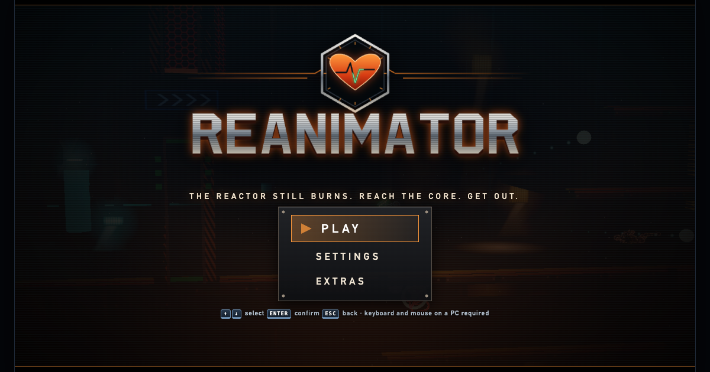
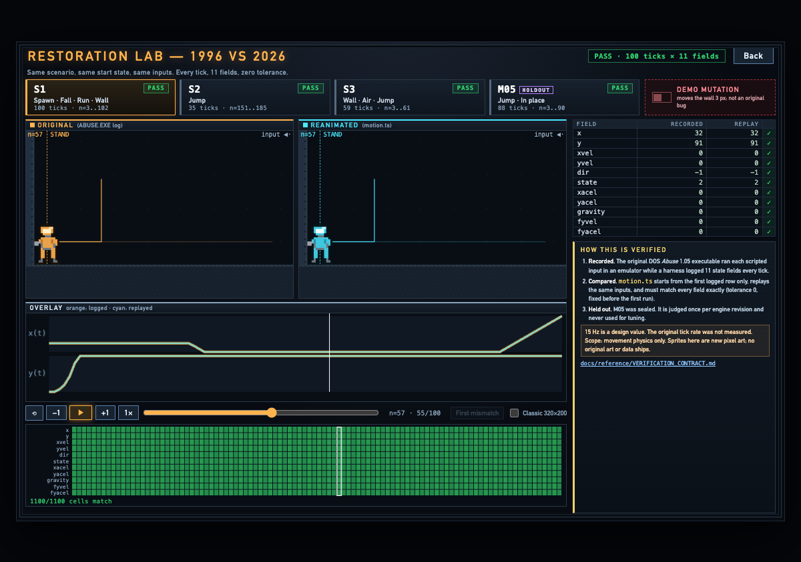
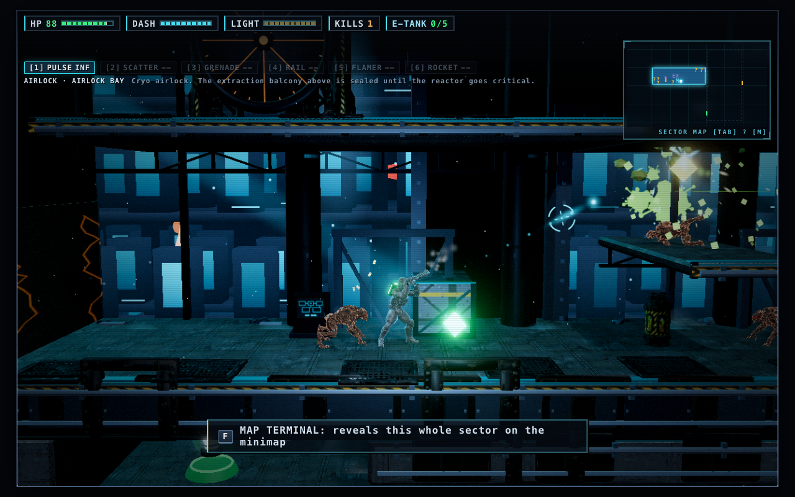
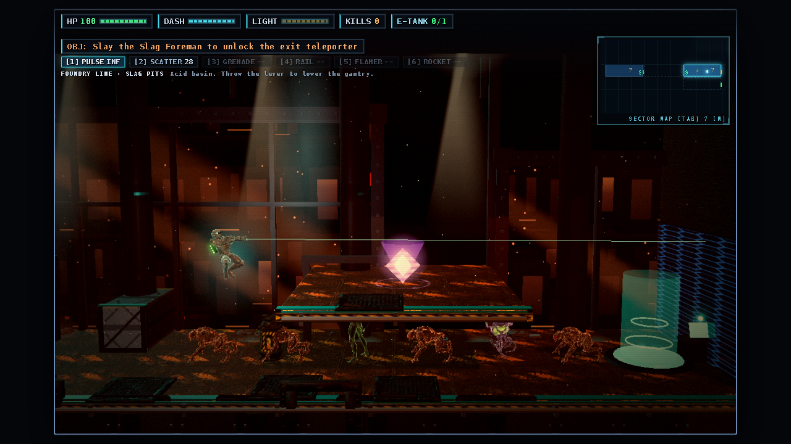
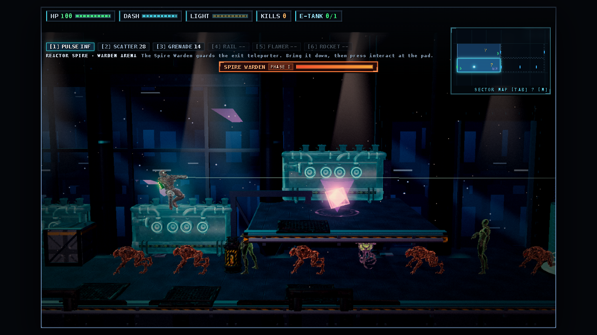
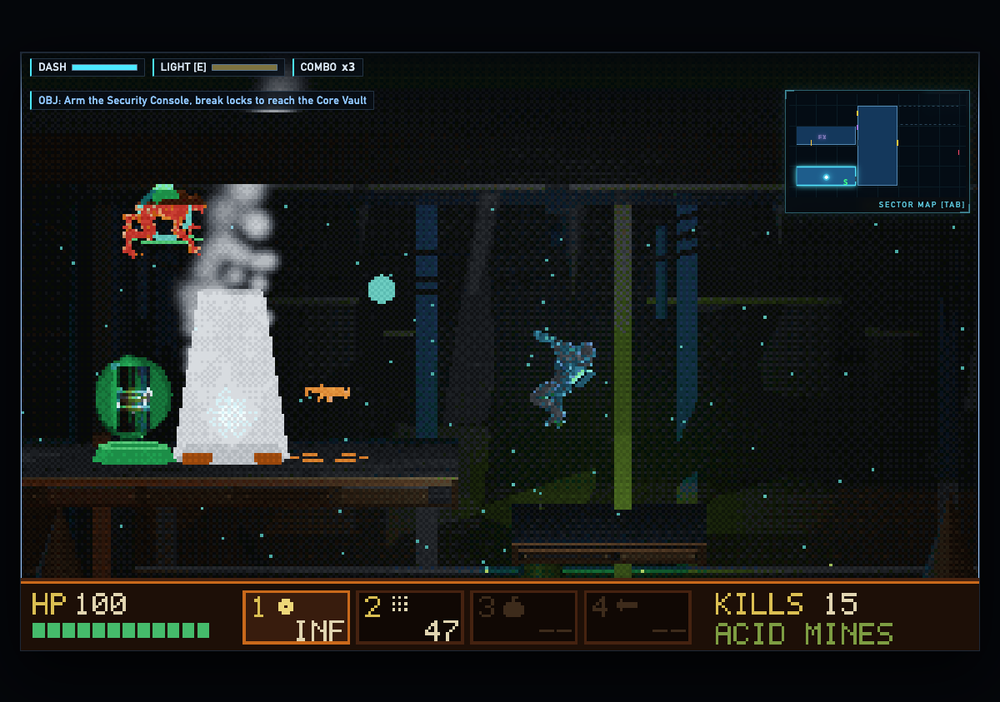

# I Rebuilt a 1995 DOS Game in WebGL2—So Why Did It Break on Tick 59? Zero-Tolerance Physics Restoration & Parallel Kiro Workflows

_Reverse-engineering ABUSE.EXE past its DOS/4GW stub, pinning 11 physics fields at zero tolerance, and scaling a clean-room 3D metroidvania with Kiro Specs, Steering, Agent Hooks, Worktrees, and MCP._



**Play live:** https://dlr55kf9v2hn7.cloudfront.net · **Trailer (1m 12s):** https://youtu.be/TvyT1M4yLzY · **Code (MIT):** https://github.com/men16922/REANIMATOR · **Devpost:** https://devpost.com/software/reanimator

*Written as part of the **Kiroween 2026 Hackathon** (Resurrection category).*

Resurrecting a classic DOS action game for the modern web usually falls into one of two traps. Wrap the original executable inside an emulator and the controls feel authentic, but the codebase stays frozen in 1995 and you end up bundling copyrighted binaries into your build. Rewrite the physics by feel in TypeScript instead, and every jump looks fine on dev tests until subtle timing bugs quietly warp the game feel.

Our failure arrived on **tick 59**. When we judged our TypeScript physics engine against a blind trace recorded from the original *Abuse* DOS Shareware `1.05` binary, a single unmodeled edge case triggered an `xacel` mismatch on the very first holdout run. By locking down **only the core movement engine under a zero-tolerance contract**—while building an original 3D metroidvania on top in a clean-room repository—**Kiro** let us preserve 30-year-old jump feel across **14 parallel sub-agent rounds** and **768 passing checks** without leaking a single byte of the 1995 executable.

| Stage | Bottleneck Hit | Root Cause Found | Fix & Verified Metric |
| :--- | :--- | :--- | :--- |
| **1. Binary Unpacking** | Decompiler showed only a tiny 16-bit stub | `ABUSE.EXE` wraps a 32-bit LE body inside DOS/4GW | `scripts/le2elf.py` applied **17,885** fixups ➔ **1,544** procedures & **289** Lisp builtins |
| **2. Physics Lock** | Dev scenarios passed; blind holdout `M04` failed at `n=59` | Missing terminal-velocity `yacel = 0` reset & air wall rule | Restored `0x14760`/`0x3a1d8`; sealed `M05` passed (`4/4`, **3,102** exact fields) |
| **3. Kiro Guardrails** | 14 parallel worktree rounds risked mutating physics | Agent sessions need persistent contracts & save gates | Always-on `.kiro/steering` + `PostFileSave` hook ➔ `make check` **768/768 PASS** |
| **4. Clean-Room Ship** | Unit tests stayed green while UI/WebGL bugs broke Chrome | CSS animation conflicts, buffer 7-vs-8 bugs, font crushing | Playwright MCP + `dist-guard` (**56** files, **20.78 MB**, **0** original bytes) |

<details>
<summary><b>Key terms & architecture glossary</b></summary>

| Term | Meaning | Role in REANIMATOR |
| :--- | :--- | :--- |
| **DOS/4GW LE** | Linear Executable format placed behind a 16-bit MZ stub so 1990s DOS games could run in 32-bit protected mode. | `ABUSE.EXE` (`1995-09-20`) stores its 32-bit body at offset `0x290a4`; converting LE to ELF exposed all 1,544 functions to Ghidra 12.2. |
| **8-bit Fractional Accumulators** | Integer math storing sub-pixel velocity/acceleration carry in `0..255` (`fyvel`, `fyacel`). | Every gravity tick adds `GRAVITY_FRAC = 200` and promotes `+1` to integer speed only on 8-bit overflow (`>> 8`). |
| **Sealed Holdout** | An untouched ground-truth recording never inspected during implementation and judged once per engine revision. | After holdout `M04` exposed a bug, it moved to dev (`S3`) and an untouched pre-fix holdout `M05` (`88` rows) passed cleanly. |
| **Kiro Steering & Hook** | Persistent workspace rules injected into every session plus automated commands triggered on file save. | `.kiro/steering/reanimator.md` locks sealed files; `.kiro/hooks/engine-gate-on-save.json` triggers `make check`. |

</details>

---

## 1. Why "Close Enough" Physics Fails—and Hitting the DOS/4GW Wall

In *Abuse* (DOS Shareware `1.05`, SHA-256 `8ba92587…1074f`), movement feel hides in integer asymmetries. Pressing right from idle jumps straight to `xvel = +9` on tick 1 (`0x3a265`), whereas pressing left steps through `-8` before hitting `-9` (`0x3a27e`). Approximate that in floating point with `dt * gravity`, and trajectories drift out of sync within seconds.

To verify behavior down to single ticks, we needed both a static call graph and frame-exact runtime traces from the original binary. Inspecting `ABUSE.EXE` directly hit an immediate wall: our reverse-engineering CLI only saw a 16-bit MZ stub at `0x0`, missing the DOS/4GW extender, inner MZ at `0x26654`, and the real 32-bit LE executable starting at `0x290a4`.

Writing `scripts/le2elf.py` broke that logjam. Parsing the LE header and applying **17,885 fixups** produced a clean 32-bit ELF image that Ghidra `12.2` (with an arm64 native decompiler compiled from source for Apple Silicon) unpacked completely:

- **Full disassembly surface:** `2` segments, **1,544** procedures (`1,544/1,544` decompiled), **2,061** strings, and **289** registered Lisp builtins (`builtin_table.json`).
- **Mapped motion call chain:** input hook `0xc8ff4` ➔ `cop_mover` (`0x14760`) ➔ `mover` (`0x3a1d8`) ➔ integrator (`0x38704`) ➔ `try_move` (`0x37e82`) ➔ tile clip (`0x558e5`).
- **Byte-identical ground truth:** Running the unmodified binary inside DOSBox Staging `0.83.0` (`cycles 20000`) with an instrumented Lisp input harness (`HARNESS.v7.LSP`, later `v8`) across three runs per scenario yielded identical SHA-256 hashes down to the byte.

Writing that Lisp harness even surfaced original memory-allocator quirks (`0x3027d`, `0x25be7`): temporary Lisp integers cleared across ticks (`"is not a number"`), and string literals inside cached user functions overflowed space `#2` (`"cannot malloc 8 bytes in space #2"`), forcing our harness to store globals in permanent space and append logs tick-by-tick to `HLOG.TXT`.

---

## 2. An 11-Field Zero-Tolerance Contract—and Failing Blind Holdout `M04`

Before running a single line of TypeScript, we froze `reference/fixtures/scenarios.json` with a hard rule: all **11 measured fields** (`x, y, xvel, yvel, dir, state, xacel, yacel, gravity, fyvel, fyacel`) must match with **zero tolerance**, and thresholds may never be widened after a failure.

Development scenarios `S1` (`n3–102`, 100 rows) and `S2` (`n151–185`, 35 rows) turned green. Then we ran our very first blind holdout check on `M04`.

**It failed immediately.** At tick `n=59`, expected `xacel` was `-8`, while our engine output `0`.

Instead of fudging constants, we preserved `holdout_M04_result.FIRST_JUDGEMENT.jsonl` as read-only evidence and went back to `0x14760` and `0x3a1d8` in Ghidra. Three missing rules explained the divergence:

1. **Terminal-velocity reset (`0x14760 cop_mover`):** Whenever `gravity === 1` and `yvel > 10`, the binary doesn't just cap fall speed—it zeros `yacel = 0` and decrements `yvel` by `1`.
2. **Tick-start `state 4 -> 5` transition:** Rising jump (`state 4`) flips to falling (`state 5`) at the start of the tick once `yvel > 0`, before integration.
3. **Airborne wall contact (`0x3a376`):** Hitting a wall while grounded clears `xacel` and returns to idle, whereas staying airborne (`prev.gravity === 1`) preserves horizontal air-control acceleration.

Here is the exact restoration code in `src/engine/motion.ts` encoding those rules and the `0..255` fixed-point integrator:

```ts
  // ---- 0x14760 cop_mover: falling state change and terminal-velocity rule -------
  // observed: state 4 becomes 5 at tick start once yvel > 0 (hlog m04 n58->59, S2 n176->177)
  if (b.state === 4 && b.yvel > 0) b.state = 5;
  // 0x14760: `if (10 < yvel) { yacel = 0; yvel -= 1; }` (decompile lines near 0x1478x)
  if (b.gravity === 1 && b.yvel > 10) {
    b.yacel = 0;
    b.yvel -= 1;
  }
  // 0x3a376: in state 5 held xm sets xacel = +/- start_accel (air control)
  if (b.state === 5 && input.xm !== 0) {
    b.dir = input.xm;
    b.xacel = input.xm * ABILITY.start_accel;
    if (Math.abs(b.xvel + b.xacel) > ABILITY.jump_top_speed) {
      b.xacel = (b.xacel < 0 ? -ABILITY.jump_top_speed : ABILITY.jump_top_speed) - b.xvel;
    }
  }

  // ---- 0x38704: integrate -----------------------------------------------------
  b.xvel += b.xacel;
  if (b.gravity === 1) {
    const t = b.yacel >= 0 ? b.fyacel + GRAVITY_FRAC : ((-b.fyacel) & 255) - GRAVITY_FRAC;
    b.yacel += t >> 8;
    b.fyacel = t & 255;
    const b5 = b.yacel >= 0 ? b.fyacel : -b.fyacel & 255;
    const b14 = b.yvel >= 0 ? b.fyvel : -b.fyvel & 255;
    const sum = b14 + b5;
    b.yvel = b.yvel + (sum >> 8) + b.yacel;
    b.fyvel = sum & 255;
  }
```

Per section 5 of our verification contract, once `M04` was inspected it lost holdout status and moved into dev as `S3` (`59` rows). Before touching `motion.ts`, we had already captured and SHA-256-sealed a fresh untouched holdout `M05` (`88` rows, jump-in-place). After fixing the three rules, `make reference-holdout` ran once on `M05` and passed **`4/4` scenarios** across **282 ticks × 11 fields = 3,102 exact field comparisons**.

To make that proof tangible in the browser, `Extras > Physics lab` runs the exact `tools/reference` comparator live side by side against the recorded DOS log:



Toggle **Demo mutation**, and the scenario moves a single wall by **3 px** (`wallLeftX: 32 -> 35`). The 11×tick heatmap immediately flips red at tick `n=33` on `x` and jumps to the first mismatch—making verification falsifiable right inside the game UI.

---

## 3. Building a Clean-Room 3D Metroidvania with Kiro Guardrails

With `src/engine/motion.ts` verified, the harder engineering challenge began: building an original three-stage 3D sci-fi metroidvania across dozens of AI-assisted sessions without ever corrupting the sealed physics core or bloating the bundle with broken WebGL state.

That coordination layer relied on **Kiro IDE and Kiro CLI** features recorded in `docs/KIRO_USAGE.md`:

- **Five ordered Specs (`.kiro/specs/`):** `abuse-reference` ➔ `restored-motion` ➔ `reanimated-slice` ➔ `full-3d-quarter-view` (superseded) ➔ `metroidvania-3d`, tracking **85 of 91 tasks** completed (the remaining items are human playtests and the permission-blocked in-Kiro REA MCP write).
- **Always-on Steering (`.kiro/steering/reanimator.md`):** Injects the sealed-file do-not-edit list (`src/engine/motion.ts`, `reference/fixtures/**`, `reference/holdout/**`), restoration scope boundaries, and architectural invariants like `R3.3` (proving `w.light` headlamp is strictly visual-only via dual-world lockstep tests). Seven auto-included `harness-*` steering files standardize sync, diagnose, checkpoint, and release steps.
- **Custom Agent (`.kiro/agents/overnight-harness.json`):** Scopes tools and preloads harness docs when spawning autonomous verification sessions.
- **PostFileSave Agent Hook (`.kiro/hooks/engine-gate-on-save.json`):** Runs `make check` automatically whenever engine, verifier, or scenario files are saved—verified across **4 logged executions** on `2026-11-14`, all `exit=0`:

```json
{
  "version": "v1",
  "hooks": [
    {
      "name": "Run reference gate when engine or verifier changes",
      "trigger": "PostFileSave",
      "description": "Runs make check (engine tests + development reference scenarios) after the engine, verifier, or scenario file is saved. Never regenerates or edits expected data and does not run the sealed holdout.",
      "matcher": "(src/engine/.*\\.ts|tools/reference/.*\\.ts|reference/fixtures/scenarios\\.json)$",
      "action": {
        "type": "command",
        "command": "cd /Users/men1692/Desktop/AWS/Kiroween2026 && make check > docs/evidence/g2/last_hook_gate.log 2>&1; code=$?; echo \"$(date -u +%FT%TZ) make check exit=$code\" >> docs/evidence/g2/hook_runs.log; exit 0",
        "timeout": 120
      }
    }
  ]
}
```

### 14 Parallel Worktree Rounds and a Deterministic 3D Game

Protected by those guardrails, **rounds R1 through R14** fanned out 3–4 parallel sub-agents per round inside isolated git worktrees (`/private/tmp/*`), each landing local commits passing `make check` before an integration sub-agent merged branches with `--no-ff`.



Inside `src/game3d/world3d.ts`, simulation runs on a **60 Hz deterministic tick** completely decoupled from Three.js rendering (`no Math.random`), letting our automated bot (`bot3d.ts` + `nav3d.ts`) clear all three stages headlessly across **Story / Normal / Hard** difficulties:

- **Three Distinct Stages:** Stage 1 **Cryo Facility** (6 sectors, locked weapon doors, hidden fake wall, 3-phase **Core Warden**, 90s Meltdown escape with 3 endings), Stage 2 **Foundry Line** (warm ember color grading + **Slag Foreman** mini-boss), and Stage 3 **Reactor Spire** (cold blue cryo grading + front-shielded **Cryo Bulwarks** + **Spire Warden**).
- **Full Metroidvania Kit:** 6 weapons (Pulse, Scattergun, Grenade, Rail-Cannon, Flamer, Rocket), invulnerable Dash, Melee Counter (`X`/`C`), Scan Pulse (`Z`), Crawl Slide shortcuts, and **Thruster Boots** double-jump gates.
- **Zero Audio Files, Two Render Paths:** Ten retro arcade themes and all combat SFX synthesize dynamically in WebAudio (`src/ui/{themes,soundBank,audioDirector}.ts`), re-voiced per stage. Pressing **`V`** toggles live between Modern bloom/graded Three.js and **Classic View** (`src/render3d/classicView.ts`: `320×200` render target, `4×4` Bayer dithering, 256-color palette, optional CRT curve).







### Real Bugs Caught by Meshy & Playwright MCP

**Meshy MCP** (`meshy-mcp-server`) generated our **11-piece terrain kit** (`0.2 MB` per piece) instanced across all six sectors, keeping draw calls at **159–275** in Modern view and **123** in Classic (`<= 300` budget). Meanwhile, **Playwright MCP** exposed browser bugs that headless unit tests completely missed:

- **Collapsed SVG wordmark (`src/ui/brand.ts`):** CSS assembly keyframe animations overwrote glyph `<path>` `transform` attributes, stacking every letter at `(0,0)`. Moving placement transforms to wrapper `<g>` elements resolved it.
- **InstancedMesh vertex buffer overrun (`tests/render-buffers.test.ts`):** Door lamps allocated `7` instances per door while writing `8`, causing silent WebGL buffer errors until pinned by `DOOR_LAMPS_PER_DOOR = 8`.
- **Invisible Extras submenus (`src/ui/panels.ts`):** `.menu-list` entrance animations stayed stuck at `opacity: 0` on nested panels; fixed with z-index tokens, opaque panel surfaces, and `window.__reanimatorUiAudit()` asserting `elementFromPoint` hit-tests across **12 scenarios**.
- **GLSL reserved name & font crushing (`R26–R27`):** `GRADE_APPLY` declared a `gl_` variable that triggered 6 WebGL shader compile failures until renamed (`gLum`/`gCol`), and `-webkit-font-smoothing: none` crushed lowercase `m` into solid blocks on macOS Chrome until text antialiasing was restored.

---

## 4. Verification Gates, Clean-Room Release Guard & Honest Boundaries

On our final release commit (`cb6ceb4`), every automated gate in `Makefile` passes end-to-end:

- **`make check` PASS:** TypeScript `tsc`, **768/768** `node --test` unit/integration tests, `reference-verify` `3/3`, `reach` + `reach3d` pathability proofs (**52** waypoints in Stage 1 / `3,432` ticks; **33** in Stage 2 / `2,526` ticks; **32** in Stage 3 / `1,798` ticks, including anti-bypass proofs that dashes and rocket jumps cannot cheat Thruster Boots gates), Vite production build, and `dist-guard`.
- **`make reference-holdout` PASS:** **4/4** exact matches (`S1`, `S2`, `S3`, sealed `M05`).
- **`make smoke-local` PASS:** **30/30** checks in real headless Chrome (`webgl-3d`, 10 models / 11 rigged, **60.5 fps**, full Stage 1 bot clear in `4,978` ticks, `0` page errors).
- **Soak & Live Hosting:** `__reanimatorSoak(3, {trace:true})` recorded **0 leaks** (`geometries: 352`, `textures: 135/136/135`, `frameErrors: 0`), surviving 12 rapid stage swaps and forced `WEBGL_lose_context` recovery. Live CloudFront (`https://dlr55kf9v2hn7.cloudfront.net`), mobile `390×844`, extracted `release/reanimator-1.1.0-web.zip`, and `vite preview` all ran error-free in Chrome and Edge.
- **Clean-room `dist-guard` (`tools/release/check-dist.ts`):** Scans all **56 shipped files** (`20,780,733 B`) against **218** original *Abuse* SHA-256 hashes and filenames, `MZ` executable headers, `Rational Systems, Inc.` DOS/4G banners, and stripped dev/contest strings—verifying **zero** original bytes ship to players.

To keep engineering claims strictly honest, here is what remains outside scope or unverified:

- **Scope boundary:** Restoration covers flat ground acceleration (with its observed left/right asymmetry), deceleration, left wall contact, jump/ceiling/landing, and terminal velocity under observed geometry constants (`floorY 91`, `ceilY 43`, `wallLeftX 32`; `15 Hz` design tick). Slopes, ladders, RNG, AI, levels, weapons, 3D visuals, `motion3d.ts` (`60 Hz`), and WebAudio synthesis are all new design.
- **Tooling attribution:** As documented in `docs/KIRO_USAGE.md`, Codex authored early bootstrap plans and toolchain setup and an `agy` orchestrator ran the Quarter-View round (`2026-11-14`). Kiro Powers, property-based testing, and an in-Kiro REA MCP server connection (blocked on `.kiro/settings/mcp.json` write permissions; binary analysis ran via REA CLI) were not used.
- **Unverified checks:** Full **human playthrough (`G5`)**, human listening review of the R28 arcade BGM, and native **Safari/WebKit and Firefox** browser passes remain unverified (`unverified`).

---

## 5. Three Boundaries Worth Keeping in Any Resurrection Project

1. **Quarantine ground truth from creative iteration:** Putting `src/engine/motion.ts` behind Kiro always-on steering and a `PostFileSave` test hook meant 14 rounds of parallel 3D feature branches could move fast without eroding tick-exact physics.
2. **Keep holdouts blind and refusal-ready:** Failing `M04` on tick 59 and banning threshold widening forced us back into `0x14760` disassembly instead of tuning magic numbers—turning `M05` PASS into real evidence rather than self-certification.
3. **Pair headless determinism with live browser telemetry:** Decoupled `world3d.ts` let bots replay entire stages in CI, while Playwright MCP + `__reanimatorUiAudit()` / `__reanimatorSoak()` caught every CSS, WebGL buffer, shader, and font defect that Node tests couldn't see.

---

<details>
<summary><b>Appendix: Verification Commands, Metrics & Links</b></summary>

### Reproduce Checks Locally

```bash
make check               # tsc, 768 node tests, reference-verify (3/3), reach/reach3d, Vite build, dist-guard
make reference-holdout   # 4/4 PASS (S1, S2, S3, sealed M05 — 282 ticks × 11 fields = 3,102 exact checks)
make smoke-local         # 30/30 PASS in headless Chrome (60.5 fps, Stage 1 bot clear 4,978 ticks)
make release             # creates release/reanimator-1.1.0-web.zip (12,263,180 B)
```

### Key Numbers (Commit `cb6ceb4`)

| Metric | Value |
| :--- | :--- |
| LE ➔ ELF binary fixups | **17,885** fixups ➔ **1,544** procedures, **289** Lisp builtins |
| Reference motion check | **4/4** scenarios (**3,102** field comparisons, `0` tolerance) |
| Kiro workflow artifacts | **5** specs (`85/91` tasks), `PostFileSave` hook (`4/4` exit 0), **R1–R14** worktree rounds |
| Automated gates | `make check` **768/768**, `smoke-local` **30/30** (`60.5 fps`), `dist-guard` **56** files (`20,780,733 B`) |

### Project Links

- **Live WebGL2 Build (CloudFront):** https://dlr55kf9v2hn7.cloudfront.net
- **Trailer (YouTube, 1m 12s):** https://youtu.be/TvyT1M4yLzY
- **Source Code (GitHub, MIT):** https://github.com/men16922/REANIMATOR
- **Kiroween 2026 Devpost Submission:** https://devpost.com/software/reanimator

</details>
