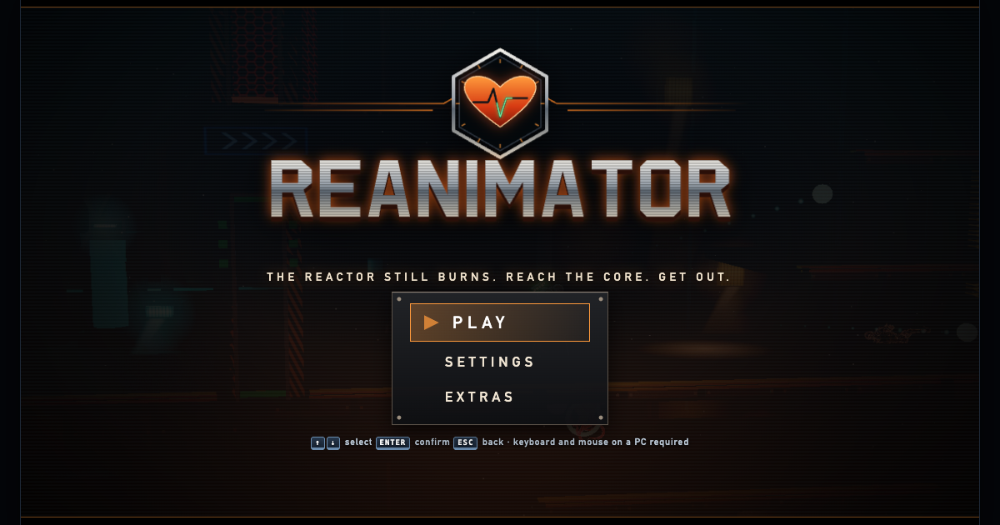
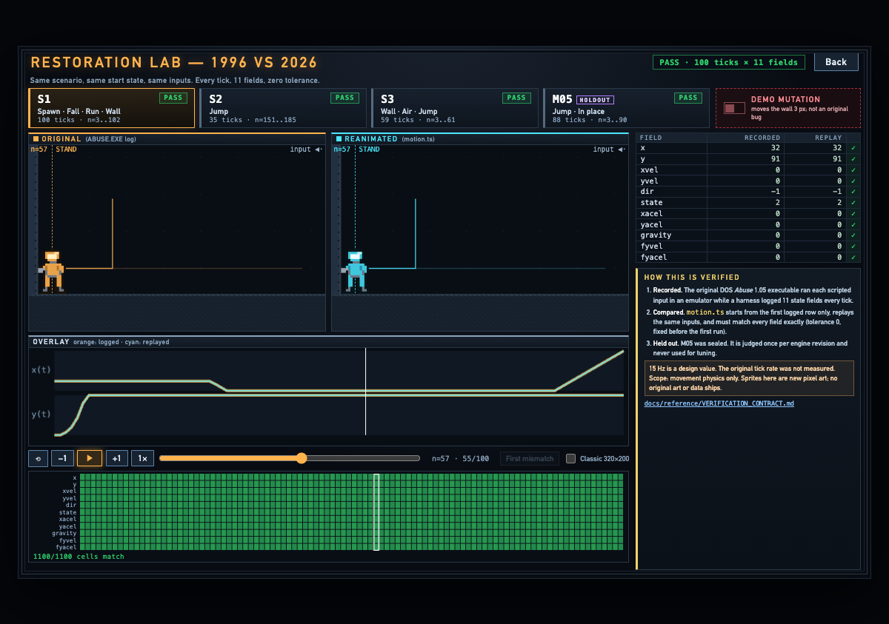
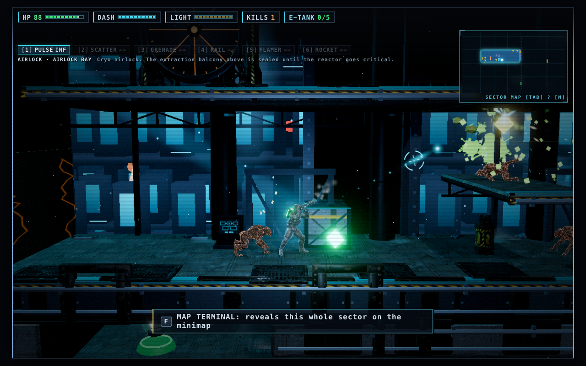
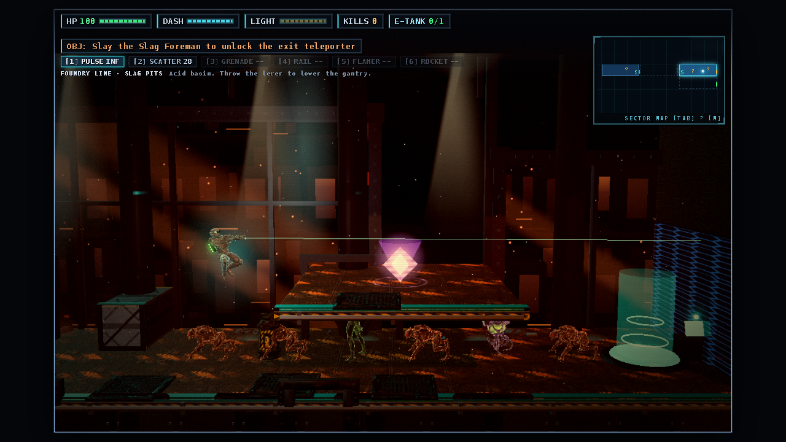
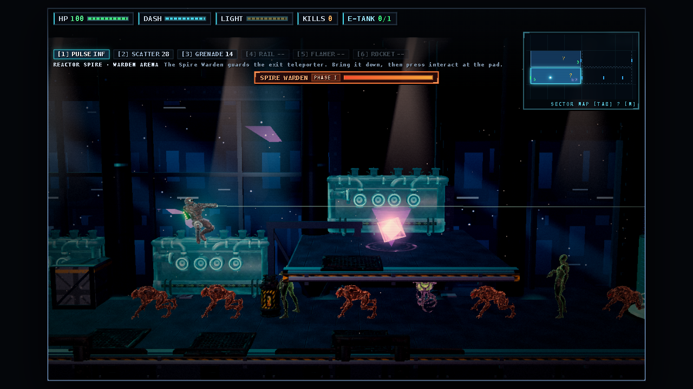
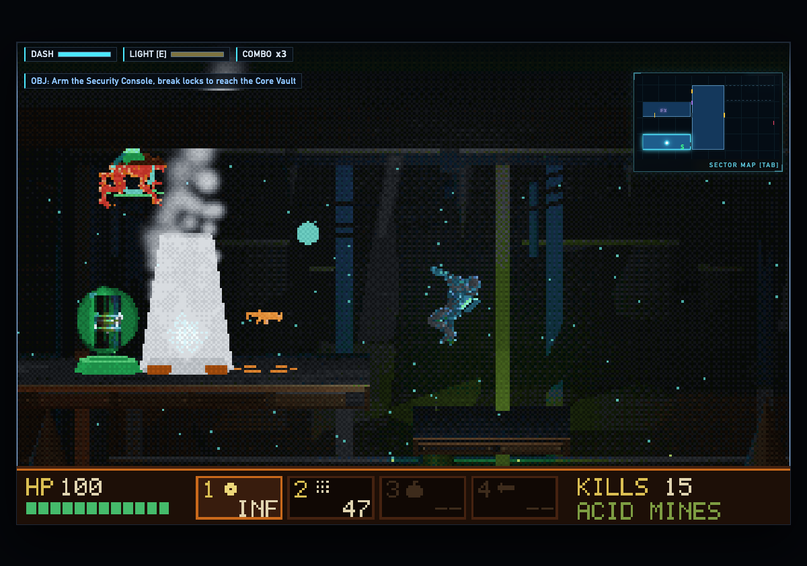

# 1995년 DOS 게임을 브라우저에서 되살렸는데, 왜 59번째 틱에서 무너졌을까: 0-오차 물리 복원과 Kiro 병렬 워크플로

_ABUSE.EXE 바이너리 역공학부터 11개 필드 0-오차 물리 계약, 그리고 Kiro 스펙·훅·병렬 워크트리 서브에이전트로 3D 메트로이드바니아 REANIMATOR를 구축한 기록_



**공개 데모:** https://dlr55kf9v2hn7.cloudfront.net · **트레일러 (1분 12초):** https://youtu.be/TvyT1M4yLzY · **코드 (MIT):** https://github.com/men16922/REANIMATOR · **제출 페이지:** https://devpost.com/software/reanimator

이 글은 **Kiroween 2026 해커톤**(Resurrection 부문) 출품작 **REANIMATOR**를 설계하고 검증하며 남긴 엔지니어링 기록이다.

고전 DOS 액션 게임을 웹으로 되살리는 작업에는 두 가지 뻔한 함정이 있다. 첫째는 원본 실행 파일을 에뮬레이터에 그대로 감싸 올리는 방법이다. 화면과 조작감은 그대로지만 소스 코드 구조는 1995년에 멈추고, 배포 번들에 원본 바이너리와 저작권 자산이 함께 묶인다. 둘째는 감으로 물리를 다시 짜는 방법이다. 개발 환경에서 테스트 몇 개를 돌려 보면 점프와 달리기 모두 그럴듯해 보인다.

진짜 문제는 그다음에 찾아온다. 원본 *Abuse* DOS 셰어웨어 `1.05` 실행 로그와 틱 단위로 대조해 보니, 대충 맞춘 엔진은 59번째 틱(`M04` 홀드아웃)에서 가속도 오차를 뿜으며 무너졌다. 반대로 **원본 이동 물리만 0-오차 계약으로 봉인한 뒤**, 나머지 3D 메트로이드바니아 전체를 클린룸 신규 설계로 올리면 30년 된 조작감과 현대 브라우저 그래픽을 한 프로젝트에 공존시킬 수 있다. **Kiro**의 스펙(Spec), 상시 스티어링(Steering), 저장 후 자동 검증 훅(Hook), 병렬 git worktree 서브에이전트, 그리고 Meshy·Playwright MCP가 바로 이 봉인 경계를 지키며 **14라운드** 병렬 확장 속에서도 **768개** 자동 테스트를 통과시킨 축이었다.

| 본문 위치 | 마주치는 질문 | 직접 확인한 원인 | 적용한 해결 설계 및 실측 결과 |
| :--- | :--- | :--- | :--- |
| **1장 (DOS/4GW)** | 왜 디컴파일러가 게임 로직을 못 읽을까? | `ABUSE.EXE` 앞단의 16비트 MZ stub만 인식됨 | `scripts/le2elf.py`로 **17,885개** fixup 적용 ➔ **1,544개** 프로시저·**289개** Lisp 빌트인 확보 |
| **2장 (홀드아웃)** | 개발 시나리오는 통과했는데 왜 `M04`가 깨졌을까? | 종단 속도 `yacel = 0` 리셋 등 3가지 바이너리 분기 누락 | `0x14760`·`0x3a1d8` 복원 후 봉인 `M05` 재판정 **PASS** (`4/4` · **3,102개** 필드 **0-오차**) |
| **3장 (Kiro 개발)** | 14라운드 병렬 작업 중 물리 코어가 왜 안 망가졌을까? | 세션마다 수정 금지 파일과 검증 게이트를 잊는 문제 | `.kiro/steering` + `PostFileSave` 훅 + `worktree` 병합 게이트 (`make check` **768/768**) |
| **4장 (클린룸·브라우저)** | 단위 테스트가 다 녹색인데 왜 화면과 빌드가 어긋날까? | CSS/SVG 변형 충돌·인스턴스 버퍼 크기 불일치·폰트 뭉개짐 | Playwright MCP + `dist-guard` (**56개** 파일, **20.78MB**, **218종** 원본 해시 대비 **0건** 혼입) |

<details>
<summary><b>📖 처음 읽는 분을 위한 핵심 용어 정리 (펼쳐 보기)</b></summary>

| 용어 | 쉬운 풀이 | REANIMATOR 적용 지점 |
| :--- | :--- | :--- |
| **DOS/4GW LE** | 1990년대 DOS 게임이 32비트 보호 모드를 쓰기 위해 16비트 스텁 뒤에 붙인 Linear Executable 실행 형식이다. | `ABUSE.EXE` (타임스탬프 `1995-09-20`) 내부 오프셋 `0x290a4`의 본체를 ELF로 변환해 Ghidra로 열었다. |
| **고정소수 누산기 (`fyvel`, `fyacel`)** | 부동소수점 대신 `0..255` 범위 8비트 정수로 중력과 속도의 소수점 아래 값을 누적하는 기법이다. | 매 틱 `GRAVITY_FRAC = 200`을 더해 `256`이 넘을 때만 정수 속도에 `+1`을 올린다. |
| **봉인 홀드아웃 (`Holdout`)** | 구현 도중 규칙을 맞추는 데 쓰지 않고 끝까지 감춰 둔 1회성 검증 시나리오다. | 첫 홀드아웃 `M04` 실패 후 개발 세트로 옮기고, 사전 봉인된 `M05`(`88행`)를 단 한 번 판정했다. |
| **Kiro Steering · Hook** | 매 에이전트 세션에 자동 주입되는 규칙 문서와 파일 저장 시 자동 실행되는 셸 게이트다. | `.kiro/steering/reanimator.md`가 봉인 파일 목록을 잠그고 `PostFileSave` 훅이 `make check`를 돌린다. |

</details>

---

## 1. "비슷한 점프"가 실패하는 이유와 DOS/4GW의 벽

### 1.1 점프 감각은 프레임당 가속도 1비트에서 갈린다

원본 게임의 손맛을 흉내 낼 때 가장 먼저 손이 가는 값은 대략적인 중력 상수와 최고 속도다. 하지만 *Abuse* (DOS Shareware `1.05`, SHA-256 `8ba92587…1074f`)의 움직임은 흔한 부동소수점 물리가 아니었다.

실제 정지 상태에서 오른쪽으로 출발하면 첫 틱에 `xvel`이 곧장 `+9`로 뛰지만, 왼쪽으로 출발하면 `-8`을 먼저 밟고 다음 틱에 `-9`가 된다. 정지와 가속, 벽 접촉, 그리고 공중에서 낙하로 전환되는 찰나의 정수 연산이 1비트만 달라져도 몇 초 뒤 캐릭터 위치와 점프 정점이 엇갈린다.

이 차이를 추측이 아닌 수치로 고정하려면 원본 실행 파일이 틱마다 내놓는 내부 상태를 직접 뜯어봐야 했다. 바로 앞에서 첫 번째 장벽이 기다리고 있었다.

### 1.2 Ghidra와 리버스 엔지니어링 CLI가 본 것은 빈 껍데기였다

`ABUSE.EXE`를 처음 프로젝트 범위의 REA CLI로 열어 보니 프로시저가 본체 없이 앞단 스텁만 16비트 모드로 잡혔다. `ABUSE.EXE`가 `0x0`의 16비트 MZ stub, DOS/4GW extender, `0x26654`의 내부 MZ, `0x290a4`의 32비트 LE 본체로 겹겹이 싸여 있었기 때문이다.

범인은 실행 파일 포맷 경계였다. 16비트 real-mode 기준으로 설계된 DOS 로더가 32비트 보호 모드 LE 본체를 따라가지 못했던 것이다. 이 벽을 넘으려고 `scripts/le2elf.py`를 작성해 LE 헤더와 **17,885개** fixup을 직접 파싱하고 32비트 ELF 바이너리로 변환했다.

변환본을 프로젝트 내부의 Ghidra `12.2`(Apple Silicon arm64 네이티브 디컴파일러를 C++ 소스에서 직접 빌드해 붙였다)와 REA CLI에 올리자 판이 완전히 열렸다.

- **코드 가시성 확보:** 스텁만 보이던 바이너리에서 **2개** 세그먼트, **1,544개** 프로시저, **2,061개** 문자열이 그대로 디컴파일됐다.
- **엔진 경로 연결:** 입력 훅 `0xc8ff4`에서 `cop_mover` (`0x14760`), `mover` (`0x3a1d8`), 적분 루틴 `0x38704`, 충돌 검사 `try_move` (`0x37e82`)를 거쳐 타일 충돌 `0x558e5`까지 이어지는 호출 사슬과 **289개** Lisp 빌트인 테이블(`builtin_table.json`)을 추출했다.
- **무결성 검증:** DOSBox Staging `0.83.0`(고정 `cycles 20000`)에서 계측 Lisp 하네스(`HARNESS.v7.LSP` → `v8`)로 3회 반복 실행해 **바이트 단위로 SHA-256이 완전히 같은 상태 로그**를 얻었다.

하네스를 짜는 과정도 순탄치 않았다. 초기 실행에서는 `"cannot malloc 8 bytes in space #2"`나 `"is not a number"` 같은 런타임 오류가 터졌는데, `0x3027d`와 `0x25be7` 메모리 할당 경로를 바이너리에서 추적해 문자열 리터럴을 영구 공간으로 옮기고 리스트 누적 대신 매 틱 파일 append 방식으로 바꿔 해결했다.

이제 원본 기계어 실행 로그라는 정답지가 손에 들어왔다. 다음 질문은 명확하다. **언제 복원이 끝났다고 말할 수 있는가.**

---

## 2. 11개 필드 0-오차 계약과 59번째 틱의 정직한 실패

### 2.1 허용 오차 0, 예외 1개도 허용하지 않는 비교 계약

감으로 "비슷해 보인다"고 결론 내리는 순간 복원은 무의미해진다. 그래서 TypeScript 엔진을 한 줄도 실행하기 전에 검증 계약(`docs/reference/VERIFICATION_CONTRACT.md`)과 시나리오 스키마(`reference/fixtures/scenarios.json`)에 판정 기준을 못 박았다.

측정 대상은 **11개** 필드(`x`, `y`, `xvel`, `yvel`, `dir`, `state`, `xacel`, `yacel`, `gravity`, `fyvel`, `fyacel`) 전부이며 허용 오차는 **0**이다. 이 기준은 설령 `FAIL`이 나더라도 뒤늦게 넓히지 않기로 했다. 게다가 개발 시나리오(`S1`, `S2`)만 통과하는 과적합을 막기 위해, 구현 도중에는 내용을 절대 열어 보지 않는 **블라인드 홀드아웃 `M04`**를 별도로 봉인했다.

개발 세트 `S1`(`n3–102`, 100행)과 `S2`(`n151–185`, 35행)를 맞춘 뒤, 떨리는 마음으로 첫 홀드아웃 판정 명령을 내렸다. 결과는 참패였다.

### 2.2 59번째 틱에서 터진 `M04 FAIL`과 `0x14760` 해부

첫 홀드아웃 `M04`는 **단 1회의 판정에서 곧바로 `FAIL`을 뱉었다.** 정확히 `n=59` 시점에서 `xacel` 기대값은 `-8`이었는데 엔진이 계산한 값은 `0`이었다. 개발 시나리오에서는 완벽하게 맞던 물리 엔진이 새로운 조합(벽에 닿은 채 떨어지며 수평 입력이 들어가는 상황)을 만나자 59번째 틱에서 속을 드러낸 셈이다.

원인을 숨기거나 수치를 깎아 맞추는 대신, `holdout_M04_result.FIRST_JUDGEMENT.jsonl`을 읽기 전용 증거로 남기고 다시 바이너리(`0x14760`, `0x3a1d8`)를 열었다. 범인은 엔진에 빠져 있던 **세 가지 조건문**이었다.

1. **종단 속도 리셋 (`0x14760 cop_mover`):** 중력으로 `yvel`이 `10`을 넘는 순간 바이너리는 단순히 속도를 막는 것이 아니라 `yacel = 0`으로 초기화하고 `yvel`을 `1` 깎는다.
2. **틱 시작 시 상태 전이:** 상승 점프(`state 4`)가 하강(`state 5`)으로 바뀌는 판정은 적분 끝이 아니라 `yvel > 0` 조건으로 다음 틱 시작 지점에서 실행된다.
3. **공중 벽 충돌 시 가속도 유지:** 바닥에 서 있을 때(`gravity === 0`) 벽에 막히면 `xacel`을 지우고 대기 상태로 돌아가지만, 공중에서 벽에 닿아 있을 때는 `state 5` 수평 가속도를 버리지 않는다.

아래는 실제 봉인된 엔진 `src/engine/motion.ts`에서 이 바이너리 분기와 8비트 고정소수 적분이 구현된 핵심 대목이다.

```ts
  // ---- 0x14760 cop_mover: falling state change and terminal-velocity rule -------
  // observed: state 4 becomes 5 at tick start once yvel > 0 (hlog m04 n58->59, S2 n176->177)
  if (b.state === 4 && b.yvel > 0) b.state = 5;
  // 0x14760: `if (10 < yvel) { yacel = 0; yvel -= 1; }` (decompile lines near 0x1478x)
  if (b.gravity === 1 && b.yvel > 10) {
    b.yacel = 0;
    b.yvel -= 1;
  }
  // 0x3a376: in state 5 held xm sets xacel = +/- start_accel (air control)
  if (b.state === 5 && input.xm !== 0) {
    b.dir = input.xm;
    b.xacel = input.xm * ABILITY.start_accel;
    if (Math.abs(b.xvel + b.xacel) > ABILITY.jump_top_speed) {
      b.xacel = (b.xacel < 0 ? -ABILITY.jump_top_speed : ABILITY.jump_top_speed) - b.xvel;
    }
  }

  // ---- 0x38704: integrate -----------------------------------------------------
  b.xvel += b.xacel;
  if (b.gravity === 1) {
    const t = b.yacel >= 0 ? b.fyacel + GRAVITY_FRAC : ((-b.fyacel) & 255) - GRAVITY_FRAC;
    b.yacel += t >> 8;
    b.fyacel = t & 255;
    const b5 = b.yacel >= 0 ? b.fyacel : -b.fyacel & 255;
    const b14 = b.yvel >= 0 ? b.fyvel : -b.fyvel & 255;
    const sum = b14 + b5;
    b.yvel = b.yvel + (sum >> 8) + b.yacel;
    b.fyvel = sum & 255;
  }
```

고정소수 누산기(`fyacel`, `fyvel`)는 매 틱 `200`(`GRAVITY_FRAC`)을 더해 하위 8비트(`& 255`)만 남기고, `>> 8` 자리올림이 생길 때만 정수 속도(`yacel`, `yvel`)를 바꾼다. 부동소수점 `dt * g` 근사로는 59틱 뒤에 `0` 오차를 유지할 수 없는 이유다.

### 2.3 새 홀드아웃 `M05` 통과와 인게임 Physics Lab 검증

검증 계약 §5에 따라 이미 원인을 열어 본 `M04`는 홀드아웃 지위를 박탈하고 개발 세트 `S3`(`n3–61`, 59행)로 편입했다. 이어서 엔진 수정 전 원본 바이너리에서 따로 생성해 해시만 기록하고 내용물을 보지 않은 **새 블라인드 홀드아웃 `M05`**(`n3–90`, 88행)에 대해 `make reference-holdout`을 단 한 번 실행했다. 결과는 전 구간 일치 **PASS**(`4/4` 시나리오, 총 `282`틱 × `11`필드 = **3,102개 필드 값 0-오차**)였다.

| 시나리오 ID | 구분 | 검증 구간 | 검사 행 수 | 판정 상태 | 비고 |
| :--- | :--- | :--- | ---: | :--- | :--- |
| `S1-spawn-fall-run-wall` | 개발 (`M01·M03`) | `n3–102` | 100 | **PASS** | 낙하·좌우 비대칭 출발·좌측 벽 |
| `S2-jump` | 개발 (`M02`) | `n151–185` | 35 | **PASS** | 점프 상승·천장·착지 3틱 타이머 |
| `S3-wall-air-jump` | 개발 (전 `M04`) | `n3–61` | 59 | **PASS** | 첫 홀드아웃 FAIL 원인 수정 후 편입 |
| `M05-holdout-jump-in-place` | **블라인드 홀드아웃** | `n3–90` | 88 | **PASS** | 수정 전 사전 생성·단 1회 판정 통과 |

이 검증을 심사위원과 플레이어가 브라우저 안에서 직접 만져 볼 수 있도록 `Extras` → `Physics lab` 화면을 구현했다.



화면 오른쪽의 **11개 필드 × 틱 히트맵**은 실제 `make check`와 같은 `verify` 엔진(`src/ui/lab.ts` + `tools/reference/scenario.ts`)을 브라우저에서 돌려 모든 틱이 녹색으로 일치함을 보여 준다. 여기서 `Demo mutation` 체크박스를 켜면 시나리오의 왼쪽 벽 X 좌표를 `32`에서 `35`로 단 **3px** 옮긴다. 그 즉시 33번째 틱 `x` 필드에서 적색 `FAIL`이 터지며 첫 불일치 틱으로 점프한다. `0`-오차 검증이 장식이 아님을 증명하는 실시간 반증 장치다.

이제 복원 엔진이라는 단단한 심장이 만들어졌다. **그렇다면 이 심장을 다치지 않게 감싸면서, 완전히 새로운 3D 메트로이드바니아 게임은 어떻게 만들었을까?**

---

## 3. 봉인된 물리 위에 3D 메트로이드바니아를 올린 Kiro 워크플로

### 3.1 왜 멀티 에이전트 작업에서 코어 엔진이 잘 깨지는가

코어 물리를 맞췄더라도 그 위에 스테이지 3개, 보스 3종, 무기 6종, 셰이더 후처리, 절차적 BGM까지 얹으려면 수십 번의 병렬 작업이 필요하다. 에이전트 세션이 바뀔 때마다 "이 파일은 고치지 말고, 수정 뒤엔 이 검증을 돌려라"는 규칙이 머릿속에서 증발하면, 어느 라운드에선가 `motion.ts`가 슬쩍 고쳐져 3,102개 일치가 깨진다.

이 문제를 막기 위해 **Kiro IDE와 Kiro CLI** 기능을 계층형 안전장치로 엮었다(`docs/KIRO_USAGE.md`).

- **Specs (`.kiro/specs/`):** `abuse-reference` ➔ `restored-motion` ➔ `reanimated-slice` ➔ `full-3d-quarter-view` (초기안) ➔ `metroidvania-3d`까지 **5개 스펙**을 순서대로 작성해 91개 태스크 중 **85개**를 완료했다(미완료 6건은 사람 플레이테스트와 REA MCP 권한 차단 항목이다).
- **Steering (`.kiro/steering/reanimator.md`):** 상시 포함(`inclusion: always`) 지침에 **봉인 파일 목록**(`src/engine/motion.ts`, `reference/fixtures/**`, `reference/holdout/**`)을 박아 두었다. 또한 헤드램프 `w.light`는 렌더·HUD 전용이며 게임 시뮬레이션 로직에서 읽지 않는다는 계약(`R3.3`)을 명시하고 테스트로 강제했다.
- **Custom Agent (`.kiro/agents/overnight-harness.json`):** 장기 세션 에이전트가 시작과 동시에 게이트 설정과 `harness-*` 절차 문서를 로드하도록 도구를 제한했다.

여기에 저장할 때마다 자동으로 게이트를 때리는 **PostFileSave Agent Hook**을 걸었다. 아래는 저장소 `.kiro/hooks/engine-gate-on-save.json` 전문이다.

```json
{
  "version": "v1",
  "hooks": [
    {
      "name": "Run reference gate when engine or verifier changes",
      "trigger": "PostFileSave",
      "description": "Runs make check (engine tests + development reference scenarios) after the engine, verifier, or scenario file is saved. Never regenerates or edits expected data and does not run the sealed holdout.",
      "matcher": "(src/engine/.*\\.ts|tools/reference/.*\\.ts|reference/fixtures/scenarios\\.json)$",
      "action": {
        "type": "command",
        "command": "cd /Users/men1692/Desktop/AWS/Kiroween2026 && make check > docs/evidence/g2/last_hook_gate.log 2>&1; code=$?; echo \"$(date -u +%FT%TZ) make check exit=$code\" >> docs/evidence/g2/hook_runs.log; exit 0",
        "timeout": 120
      }
    }
  ]
}
```

이 훅은 `src/engine/*.ts`, `tools/reference/*.ts`, `scenarios.json` 저장 시 즉시 `make check`를 돌리되 홀드아웃(`reference-holdout`)은 절대 건드리지 않는다. 실제로 `2026-11-14` 하루 동안 `08:53:05Z`, `08:53:12Z`, `09:06:48Z`, `09:07:05Z` 네 차례 자동 실행되어 모두 `exit=0`을 `docs/evidence/g2/hook_runs.log`에 남겼다.

### 3.2 14라운드 병렬 Worktree와 3스테이지 메트로이드바니아 구축

이 가드레일 위에서 본격적인 게임 확장은 **R1부터 R14까지의 병렬 git worktree 서브에이전트 라운드**로 밀어붙였다. 각 라운드마다 게임플레이, 렌더링, 적 AI, 오디오, UI를 맡은 3~4개 트랙이 `/private/tmp/...` 아래 독립 worktree와 브랜치에서 작업하고, 자기 브랜치에서 `make check`를 통과시킨 뒤 통합 에이전트가 `--no-ff`로 병합해 게이트를 다시 확인하는 구조다.



그 결과물인 **REANIMATOR**는 3D 시뮬레이션(`src/game3d/world3d.ts`)을 **60 Hz 완전 결정적 루프**로 분리해 렌더링 상태나 `Math.random`에 기대지 않는다(헤드램프가 게임플레이에 영향이 없다는 점을 두 월드의 lockstep 테스트로 증명한다).

| 스테이지 | 테마와 색 그레이딩 | 주요 보스 및 위협 요소 | 고유 아키텍처·감각 요소 |
| :--- | :--- | :--- | :--- |
| **Stage 1: Cryo Facility** | 무그레이딩 원색·6개 섹터 탐험 | **Core Warden** 3페이즈·탈출 Meltdown `90초` 카운트다운 | 무기 6종 잠금 문·숨은 가짜 벽(`Vault Nook`)·3종 엔딩 |
| **Stage 2: Foundry Line** | 웜 엠버 램프 (`#0c0605` ➔ `#ffa24a`) | 미니보스 **Slag Foreman**·용암 낙석 | 모루 타격음을 섞은 저역·저템포 절차적 BGM 리보이싱 |
| **Stage 3: Reactor Spire** | 콜드 블루 램프 (`#040810` ➔ `#b4e0ff`) | 전방 실드 **Cryo Bulwark**·**Spire Warden** | 유리 반사 틴트 분리·고역 아르페지오 절차 BGM |

<br>





플레이 중 언제든 `V` 키를 누르면 현대 3D 블룸·그레이딩 렌더러에서 **Classic View**(`src/render3d/classicView.ts`)로 즉시 전환된다. `320×200` 해상도 렌더 타깃에 `4×4` Bayer 디더링과 256색 팔레트, 직교 카메라, 선택형 CRT 곡률 셰이더를 씌운 모드로, 1995년 DOS 원작의 시각적 기억을 단일 씬의 두 번째 렌더 경로로 구현한 기능이다. 오디오 파일 역시 저장소에 **0개**다. 10개 테마 BGM과 무기·문·카운터 효과음은 모두 WebAudio로 런타임에 합성한다.



### 3.3 Meshy MCP와 Playwright MCP가 잡은 브라우저 실전 버그

R15에서 **Meshy MCP**(`meshy-mcp-server`)를 연결해 6개 섹터에 인스턴싱되는 **11종**의 터레인 킷 조각(개당 약 `0.2MB`)을 생성하고, 드로콜을 Modern **159–275**회(상한 300회 이하), Classic **123**회로 묶었다. (다만 바이너리 분석용 REA MCP는 stdio `tools/list 255`까지는 확인했으나 `.kiro/settings/mcp.json` 쓰기 권한 제약으로 Kiro 내부 연결은 하지 못하고 REA CLI로 우회했다.)

병렬 라운드를 거치며 가장 값이 비쌌던 도구는 **Playwright MCP**였다. `node:test` 단위 테스트 700여 개가 모두 녹색을 띄우는 상태에서도, 실제 Chrome을 열어 화면과 콘솔을 찍어 보지 않으면 절대 보이지 않는 버그들이 줄지어 나왔기 때문이다.

1. **타이틀 워드마크 뭉침 (`src/ui/brand.ts`):** SVG `<path>`에 준 배치 `transform`을 CSS 조립 애니메이션이 덮어써 글자들이 좌측 상단 원점에 겹쳤다. 배치 변환을 바깥 `<g>` 그룹으로 옮겨 고쳤다.
2. **문 램프 WebGL 버퍼 부족 (`tests/render-buffers.test.ts`):** `InstancedMesh` 버퍼를 문당 `7개`로 할당해 놓고 실제로는 `8개`씩 써서 WebGL 경고가 떴다. 단일 상수 `DOOR_LAMPS_PER_DOOR = 8`로 통일했다.
3. **투명해진 `Extras` 하위 메뉴 (`src/ui/panels.ts`):** `.menu-list`에 걸린 진입 애니메이션이 하위 패널에서 종료되지 않아 메뉴 목록이 투명하게 숨어 있었다. z-index 토큰과 불투명 배경, 그리고 모든 컨트롤 중심점의 `elementFromPoint`가 자기 자신인지 검사하는 `window.__reanimatorUiAudit()`(**12개 시나리오 PASS**)로 봉쇄했다.
4. **작은 영문 `m` 뭉개짐과 GLSL 예약어 (`R26`–`R27`):** macOS Chrome 스크린샷에서 `-webkit-font-smoothing: none` 때문에 `confirm`과 `metroidvania`의 `m`이 사각형으로 뭉개진 것을 보고 안티앨리어싱을 복원했다. 또한 Stage 2/3 그레이딩 셰이더에서 로컬 변수 `gl_` 접두사가 GLSL 예약어와 충돌해 셰이더 컴파일 오류 6건이 난 것을 `gLum`/`gCol`로 바꾸어 콘솔 오류 `0건`으로 정리했다.

그렇다면 이렇게 방대한 3D 게임 코드가 정말 클린룸이고, 실제 배포 환경에서도 새지 않는다는 보장은 어디에서 나올까.

---

## 4. 다층 검증 게이트, 클린룸 경계, 그리고 정직한 한계

### 4.1 768개 테스트·도달성 증명·리크 0회 소크 테스트

최종 제출 커밋(`cb6ceb4`) 기준 `make check`는 타입 검사, **768/768** 단위·통합 테스트, `reference-verify` `3/3`, 봇 도달성 증명 `reach` + `reach3d`, 프로덕션 Vite 빌드, 그리고 배포 가드 `dist-guard`를 한 번에 검사한다.

특히 `tools/game/reach3d.ts`는 단순 탐색이 아니라 **메트로이드바니아 능력 게이트의 반증 검사**를 수행한다. Stage 1의 **52개** 웨이포인트(`3,432`틱 / `57.2초`), Stage 2의 **33개**(`2,526`틱 / `42.1초`), Stage 3의 **32개**(`1,798`틱 / `30.0초`)를 전부 돌고, 로켓 점프나 대시로 **Thruster Boots** 게이트를 꼼수로 건너뛸 수 없다는 점까지 증명한다.

- **헤드리스 Chrome 스모크 (`make smoke-local`):** **30/30 PASS**, `webgl-3d` 모드, 10종 모델 / 11종 리깅 로드, **60.5 fps**, Stage 1 봇 완주 `4,978`틱, 페이지 오류 **0건**.
- **메모리·컨텍스트 소크 (`__reanimatorSoak(3, {trace:true})`):** 스테이지 교체 3회 반복 후 누수 **0건**(geometries `352`, textures `135/136/135`, `frameErrors: 0`), `WEBGL_lose_context` 복구 및 12회 고속 스테이지 전환 정상.
- **결정성 및 라이브 배포 확인:** `__reanimatorRunBot(1900)` 1회 실행과 `RunBot(1)`×1900 실행이 시뮬레이션·렌더 상태까지 동일했고, AWS CloudFront 라이브 URL(`https://dlr55kf9v2hn7.cloudfront.net`)과 모바일 `390×844` 뷰포트, 추출된 `release/reanimator-1.1.0-web.zip`, `vite preview` 모두 Chrome·Edge에서 콘솔 오류 없이 구동됐다.

### 4.2 원본 1바이트도 남기지 않는 `dist-guard`와 미검증 영역

*Abuse* 바이너리를 참조했으므로 배포 빌드에 원본 저작물이나 개발용 문구가 흘러들어 가면 안 된다. `tools/release/check-dist.ts`는 `dist/` 내 **56개 파일**(`20,780,733 B`) 전수 검사를 걸어 `abuse-source.json`의 **218개** 원본 파일 SHA-256 해시와 파일명, `MZ` DOS 실행 헤더, `Rational Systems, Inc.` DOS/4G 배너는 물론 플레이어용 빌드에 남아선 안 될 개발 도구 키워드까지 차단하고 통과했다.

프로젝트의 신뢰도를 지키기 위해 **하지 않은 것과 검증되지 않은 경계**도 그대로 남긴다.

1. **복원 범위 상한:** 복원된 것은 관찰한 평면 기하 상수(`floorY 91`, `ceilY 43`, `wallLeftX 32`) 위에서의 이동·점프·중력·벽·천장 규칙(`15 Hz` 설계값)뿐이다. 경사면, 사다리, RNG, 적 AI, 무기, 레벨, 3D 그래픽, 60 Hz 3D 이동(`motion3d.ts`), 절차 오디오는 모두 신규 설계다.
2. **에이전트 도구 사용 경계:** `docs/KIRO_USAGE.md`에 기록했듯 초기 계획·도구 정비는 Codex가 썼고 `2026-11-14` Quarter-View 전환 1라운드는 `agy` 오케스트레이터가 돌렸다. Kiro Powers와 속성 기반 테스트(PBT)는 사용하지 않았다.
3. **미실시 검증:** 자동 봇과 Chrome/Edge 스모크는 끝까지 돌렸으나, **사람의 전 구간 수동 플레이테스트**(`G5`), R28 레트로 BGM 청취 검수, 그리고 네이티브 **Safari/WebKit·Firefox 수동 검증**은 아직 미실시(`unverified`) 상태다.

---

## 5. 정리: 부활(Resurrection) 프로젝트가 지켜야 할 세 가지 경계

30년 전 DOS 게임을 현대 웹 3D 메트로이드바니아로 되살리는 과정에서 얻은 교훈은 세 가지 설계 경계로 압축된다.

1. **참조 진실과 신규 설계의 물리적 격리:** 원본에서 가져온 코어 물리(`src/engine/motion.ts`)와 새 게임 로직(`src/game3d/`)을 파일 단위로 쪼개고, `.kiro/steering`과 `PostFileSave` 훅으로 봉인 파일 수정을 자동 차단해야 14번의 병렬 라운드를 돌아도 `0`-오차가 무너지지 않는다.
2. **단 1회의 블라인드 홀드아웃 원칙:** 개발 시나리오(`S1·S2`)를 다 맞췄다고 복원이 끝난 것이 아니다. 눈을 감고 열어 본 `M04`가 `n=59`에서 깨졌을 때 허용 오차를 넓히지 않고 바이너리 `0x14760`을 다시 파서 새 홀드아웃 `M05`로 재검증한 절차 덕분에 "감으로 비슷한 점프"에서 벗어날 수 있었다.
3. **헤드리스 단위 테스트 너머의 실브라우저 감사:** `node:test` 768개는 SVG `<g>` 변환 충돌, InstancedMesh 7 vs 8 할당 실수, CSS 애니메이션 투명 메뉴, macOS 폰트 뭉개짐을 잡아내지 못했다. 결정적 시뮬레이션 테스트와 Playwright MCP 실브라우저 감사를 짝으로 돌려야 배포 직전의 침묵하는 장애를 막는다.

---

<details>
<summary><b>📊 부록: 최종 검증 명령, 주요 수치 및 관련 링크 모음 (펼쳐 보기)</b></summary>

### 검증 명령 (저장소 루트)

```bash
make check               # tsc + 768 node tests + reference-verify (3/3) + reach/reach3d + Vite build + dist-guard
make reference-holdout   # 4/4 PASS (S1, S2, S3, sealed M05 — 282 ticks × 11 fields = 3,102 exact checks)
make smoke-local         # 30/30 PASS in headless Chrome (60.5 fps, Stage 1 bot clear 4,978 ticks, 0 errors)
make release             # release/reanimator-1.1.0-web.zip (12,263,180 B)
```

### 프로젝트 수치 요약 (HEAD `cb6ceb4` 기준)

| 항목 | 실측 수치 |
| :--- | :--- |
| LE ➔ ELF 변환 적용 fixup | **17,885**건 (프로시저 `1,544`개 · Lisp 빌트인 `289`개 추출) |
| 물리 참조 검증 | `4/4` 시나리오 (**3,102** 필드 비교 0-오차, `M04` 1회 FAIL ➔ 수정 후 `M05` PASS) |
| Kiro 스펙 · 훅 · 병렬 라운드 | Spec 5종(`85/91` 태스크), `PostFileSave` 훅 `4/4` exit 0, R1–R14 worktree 병합 |
| 게임 구성 | 3 스테이지 · 6 무기 · 10 절차 WebAudio 테마 · Classic View (`320×200` Bayer 디더) |
| 테스트 및 번들 가드 | `make check` **768/768**, `make smoke-local` **30/30** (`60.5 fps`), `dist-guard` **56** 파일 (`20,780,733 B`) |

### 관련 링크

- **라이브 플레이 (AWS CloudFront):** https://dlr55kf9v2hn7.cloudfront.net
- **데모 트레일러 (YouTube, 1분 12초):** https://youtu.be/TvyT1M4yLzY
- **GitHub 오픈소스 저장소 (MIT):** https://github.com/men16922/REANIMATOR
- **Kiroween 2026 Devpost 제출 페이지:** https://devpost.com/software/reanimator

</details>
